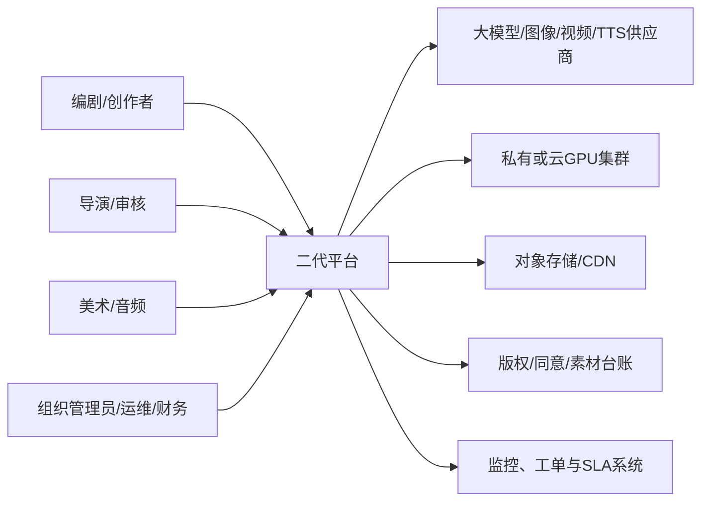
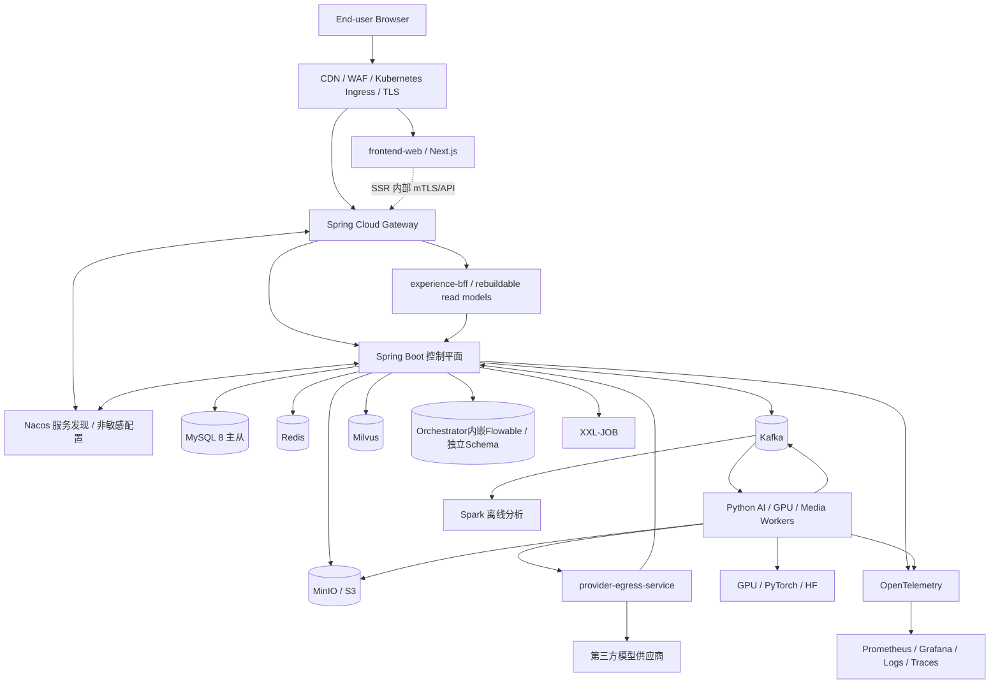
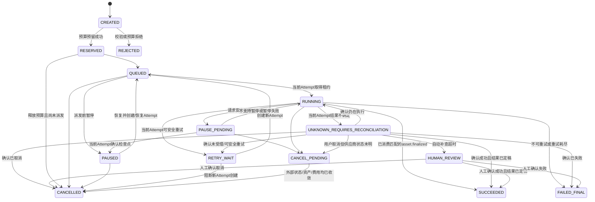
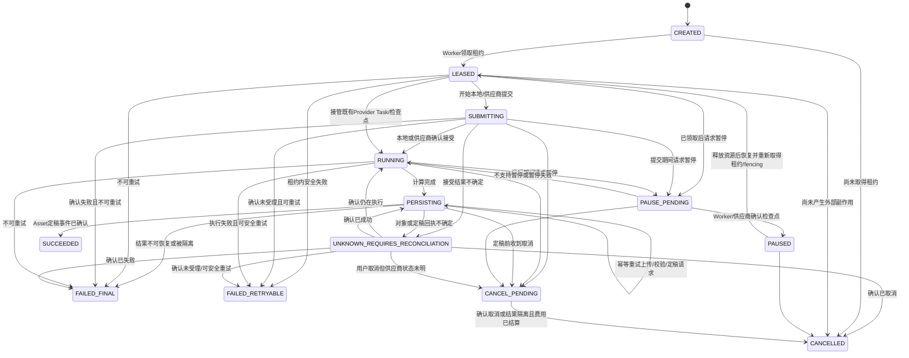

# 二代平台总体架构设计

> 文档状态：送审稿（V0.95）
> 现状基线日期：2026-08-19
> 本次修订日期：2026-08-20
> 现有工程基线：`main@9a3c8bfb`
> 需求来源：`需求文件.pdf`（采购需求第三章）
> 需求文件 SHA-256：`52ae0db5b5010a867a766de27cb4f5ddf3b7c5c7f7b32a9bafc5a99fd4a5bbd5`
> 关联实施计划：`docs/superpowers/plans/2026-08-19-second-generation-platform-domain-migration.md`
> 适用范围：二代 AI 漫剧/视频生产平台的建设、迁移、验收和运维设计

## 0. 文档控制

### 0.1 文档目的

本文定义二代平台的目标业务架构、应用架构、数据架构、技术架构、安全架构、运行架构、迁移约束和验收证据体系。它用于统一采购方、产品、研发、算法、测试、SRE、安全、法务和验收团队的实施边界。

本文不是以下材料的替代品：

- 采购合同、补充协议和正式澄清函；
- 各领域实施前的接口、数据和任务级详细设计；
- 部署参数、容量报价和生产变更单；
- 算法效果承诺、法律意见或第三方服务级别承诺。

### 0.2 状态标识

| 标识 | 含义 |
|---|---|
| **现状事实** | 已由当前仓库、当前本地样本或需求文件核验；本地数据不等于生产数据 |
| **设计决策** | 本送审稿建议采用的目标方案；审批后成为实施约束 |
| **合同阻断** | 必须由双方书面关闭；技术团队不得自行解释 |
| **建议指标** | 用于容量和架构设计，不自动成为合同验收值 |

### 0.3 审批生效条件

本文只有在下列条件同时满足后，才能由“送审稿”升级为“实施基线”：

1. `BD-001` 至 `BD-013` 均有书面结论、责任主体和生效日期；
2. 需求追踪矩阵中的每项强制需求均有验收公式、数据集、阈值和证据责任人；
3. 技术选型 ADR、数据所有权矩阵、API/事件版本策略获得批准；
4. 关联《分域迁移实施计划》完成评审；
5. 一期范围、预算、算力、第三方费用、SLA 和知识产权边界写入合同或补充协议。

任何实质性条款无责任人、指标无可计算口径、迁移域无回滚路径、IP 无来源证明或阶段与付款不一致时，评审结论只能是“退回修改”。

### 0.4 变更控制

架构基线生效后，以下变化必须提交 ADR 和影响评估：

- Java/Python 边界、消息中间件、向量库、主数据库或对象存储变化；
- 聚合写入所有权、对外 API 语义或事件主版本变化；
- 任务状态机、计费、供应商重试、质量门或版权策略变化；
- RPO、RTO、安全等级、验收阈值或服务范围变化；
- 任何可能造成历史数据、媒体、执行证据或外部供应商任务不可恢复的变化。

### 0.5 修订记录与本次深化边界

| 版本 | 日期 | 主要内容 | 状态 |
|---|---|---|---|
| V0.9 | 2026-08-19 | 建立目标架构、合同阻断、领域所有权、状态机、迁移与验收基线 | 首次送审 |
| V0.95 | 2026-08-20 | 深化采购/演示/IP追踪、服务/聚合/部署边界、ProviderOperation、动态修复/四轨/自动剪辑、数据/事件/安全/容量/DR及详细设计准入 | 本次送审 |

V0.95 不改变 V0.9 已锁定的推荐路线、ROM、阶段解释或合同责任。新增的超时、保留期、部署副本、容量和安全参数均属于**详细设计输入或建议基线**；只有进入批准的 ADR、容量报告、上线变更单或合同附件后才成为实施/验收值。

---

## 1. 执行摘要

### 1.1 核心结论

二代平台在技术上可以实现，但不能把“完全重构”理解为一次性推倒现有工程。推荐路线是：

> **架构完全重建、成果分层复用、业务逐域切换。** 采用 Spring Cloud Alibaba Java 控制平面和 Python AI/GPU/媒体执行平面，保留并演进现有 React 产品界面，通过 Gateway 兼容层和绞杀者模式逐域迁移；每个业务聚合始终只有一个写入者。

该路线同时满足三个目标：

- 遵循采购文件指定的企业框架；
- 保留现有产品、模型适配、Prompt、媒体、数据语义和测试成果；
- 避免大爆炸重写带来的功能回退、数据分叉、重复付费和长时间不可交付。

严格工业化闭环的合理 ROM 为 **9—14 个月、峰值 20—21 人、约 2780—4180 人日**，误差至少为 ±30%。20 日内合理交付的上限是：需求与验收基线、总体架构、合同栈地基、迁移工厂、一个固定数据集的垂直切片和受控演示；不能等同于完整重构或 60 批/1200 分钟工业终验。

### 1.2 意图锁定

建设一个能够持续生产、可靠恢复、完整追溯、横向扩容并满足正式验收的工业级 AIGC 漫剧平台，同时保护已有产品、数据、媒体、供应商适配和验证成果。

### 1.3 范围

本文覆盖：

- React/Next.js 创作、审核、运营和管理界面；
- Spring Cloud Gateway、Nacos 和 Spring Boot 企业控制面；
- 项目、剧本、Production Bible、实体、分镜、镜头和不可变生产合同；
- 资产、版权、模型工厂、Prompt、LoRA、ControlNet 和执行快照；
- Flowable 长流程、持久任务、Kafka、GPU Worker、XXL-JOB 对账；
- Python 文本、图像、视频、TTS、质检和 FFmpeg 执行平面；
- MySQL、Redis、Milvus、MinIO/S3、Spark、Kubernetes；
- 质量、选择性修复、时间线、渲染、交付、成本、审计和报表；
- 安全、可观测性、容量、灾备、CI/CD、迁移、验收和退役。

### 1.4 非目标

- 不机械翻译现有 FastAPI 大文件为 Spring Controller；
- 不在一期重新训练通用基础大模型；
- 不同时建设 Kafka 和 RocketMQ 两套在线消息总线；
- 不把 Flowable、XXL-JOB 或 Redis 作为 GPU 任务最终真相；
- 不把“已配置、页面可见、容器健康、一次调用成功”视为生产可用；
- 不在数据清单、备份恢复和回滚演练完成前删除旧库或旧媒体；
- 不把 20 日交付、6 个月 MVP、12 个月工业验证擅自解释为同一验收门；
- 不把本地测试数据、开发素材或占位评分包装成生产验收证据。

---

## 2. 合同约束与阻断决策

### 2.1 已识别的根本冲突

需求文件同时存在最高限价 48.5 万元、20 日内交付并验收、一期不超过 6 个月、二期不超过 12 个月并完成 60 批/1200 分钟、第三阶段持续优化、7×24 服务及源码/IP 交付等要求。这些条款不能由技术文档自行分期解释。

### 2.2 合同阻断清单

| 编号 | 必须书面关闭的问题 | 未关闭的处理 |
|---|---|---|
| BD-001 | 20 日与 6/12 个月路线的验收关系，以及第二阶段“≤12个月”从合同生效还是从第二阶段开始计算 | 不承诺完整重构；本文排期只作为累计工期假设并保持送审稿 |
| BD-002 | 100% 付款触发点与后续阶段义务 | 不启动超出明确付款范围的阶段 |
| BD-003 | 算法研究目标、最低验收值和尽力义务的边界 | 不承诺未定义的效果值 |
| BD-004 | 持续优化与固定总价、固定范围、质保期的关系 | 按变更单或独立运维合同处理 |
| BD-005 | 背景 IP、定制代码、开源组件、模型权重和第三方素材的权利 | 未完成 IP 清单的资产不得移交或投产 |
| BD-006 | 7×24、4 小时解决、8 小时到场、24 小时解决、安全漏洞及时修补，以及★采购人指定交付地点的期限、人员和成本 | 不作为无期限免费附带服务；地点未书面指定前不承诺到场成本和可达性 |
| BD-007 | “工业级、金融级、毫秒级、60%降低”等指标口径 | 不进入终验承诺 |
| BD-008 | 60 批/1200 分钟的算力、API、素材、标注和质检成本归属 | 不启动规模验收生产 |
| BD-009 | Kafka/RocketMQ、Milvus/Chroma 及 Java/Python 边界 | W1 实施前批准对应 ADR |
| BD-010 | 1000+ 分钟目标与 1200 分钟测试数据是否为同一证据 | 分开统计，直至合同明确合并口径 |
| BD-011 | 采购文件引用的“第五章符合性审查”及完整采购附件尚未取得；§6.1—6.5 使用“投标人/需提供视频演示”，演示究竟是投标响应证据、20 日交付物还是阶段验收项 | 未取得完整文件并书面确认提交时点前，不把五项演示默认排入任一付款/交付门，也不声称追踪矩阵已覆盖全部采购要求 |
| BD-012 | 原文要求承建方保证不受第三方专利、商标或工业设计等权利指控，并在发生指控时负责交涉、责任、费用和损失赔偿；其适用范围、第三方材料/模型例外、责任上限、保险和处置权限 | 保留原文义务等待法务结论；不得以技术文档弱化，也不得在未定边界时接受不可估算的无限责任 |
| BD-013 | 48.5 万元对应的阶段范围、甲供数据/GPU/云账号/场地/网络/验收人、承建方 OPEX、第三方费用、排除项和变更计价 | 未签署“范围—价格—资源—排除项”矩阵前，只开展 W0 只读盘点、设计和无付费验证 |

### 2.3 建议的阶段门

以下仅是合同重写建议，不代表采购方已经同意：

| 阶段 | 建议验收范围 |
|---|---|
| 20 日门 | 现有成果基线、总体设计、需求追踪、目标栈骨架、迁移 Dry-run 和首个无付费垂直切片；五项视频演示是否属于本门由 BD-011 决定 |
| 6 个月门 | 原文第一阶段：微服务骨架、向量库、CI/CD、剧本解析、角色管理、基础视觉一致性微调控制 MVP、可运行系统及源码/算法文档；建议另含可靠任务和最小预算/审计切片 |
| 12 个月门 | 原文第二阶段：功能完善、系统集成及 60 批/总计 1200 分钟测试数据集；期限从项目生效还是第二阶段开始计算由 BD-001 澄清 |
| 持续服务门 | 模型优化、量化剪枝、运营监控、安全维护和约定服务级别 |

采购方若拒绝书面拆分而要求 20 日完成全部新架构、算法、1200 分钟和工业指标，则项目应判定为 **No-Go**。

采购元数据中的“是否涉及进口产品、核心产品、节能产品、环境标志产品”等字段不转写为技术实现结论。W0 由采购/法务确认外部云模型、境外服务、GPU 和第三方软件是否触发相应口径，并把结论连同完整采购文件版本、页码和文件哈希登记到追踪基线。

---

## 3. 需求与架构驱动因素

### 3.1 功能驱动

| 需求域 | 目标能力 |
|---|---|
| 内容理解 | 剧本结构化、NER、关系、事件、情绪、分镜、Prompt 和视觉资产建议 |
| 角色与声音 | 身份/服饰/体态保持、LoRA/ControlNet、零样本情感 TTS、字词级时间戳 |
| 自动制作 | 镜头运动、转场、PIP、多机位、多轨、字幕、BGM、SFX、渲染与交付 |
| 生产执行 | 分布式 GPU 队列、优先级、暂停/恢复、可靠重试、完整日志、Seed 和成本 |
| 模型工厂 | 模型、制品、Prompt、配方、认证、热加载、灰度、回滚和退役 |
| 企业治理 | 职业角色 RBAC、审计、日报、GPU 利用率、质量漂移和开放 API |
| 质量修复 | 身份、服饰、动作、坏帧、音画同步检测、人工金标和选择性重生 |

### 3.2 非功能驱动

- 可支撑 1000+ 分钟生产及 60 批/1200 分钟验证；
- 角色保持、坏帧、漂移、同步和人工干预具备可计算口径；
- 控制面高可用、任务可恢复、供应商不重复付费；
- 金融或行业级安全必须落到明确标准、范围和证据；
- 微服务、开放 API、横向扩展、可观测、审计和灾备；
- 所有商业化声明由真实运行证据支持。

### 3.3 指标定义原则

任何指标必须包含：业务定义、公式、分子分母、样本选择、排除项、时间窗口、统计分位数、阈值、数据源、测试环境、责任人和失败处置。重点口径如下：

| 指标 | 必须锁定的口径 |
|---|---|
| 角色身份保持率 | 按帧或按镜头；人脸、服饰、体型是否分项；遮挡和无人帧如何排除 |
| 漂移率 | 出现任一漂移的可评估镜头数/可评估镜头总数；机器和人审冲突规则 |
| 坏帧率 | 缺脸、多肢体、文字污染、黑帧、闪烁等缺陷分类和金标集 |
| 人工干预节点降低 | 原文主口径为“全链路人工干预节点减少 60%以上”：在同类剧本、相同质量门和同一流程边界下，按批准节点目录计算 `(一代节点数-二代节点数)/一代节点数`；人工分钟和操作次数只作辅助，变更主口径需书面批准 |
| 调度延迟 | Ready 到 GPU 租约确认的 p50/p95/p99；是否包含等待资源必须明示 |
| 向量检索 | 固定查询集、候选库版本、Embedding 版本下的 Recall@K、Precision@K、无结果率和端到端 p95；离线建库时间单列 |
| 零样本情感 TTS | 固定授权样本和文本集上的音色相似度、可懂度、情感自然度/符合度、稳定性、p95 延迟和人工盲评协议 |
| 四轨同步 | 画面、对白/BGM、字幕分别绑定统一 Timeline 时钟；对白起止、字幕字词、口型/关键画面和 BGM 节拍偏差分别统计绝对误差 p50/p95/p99及超阈值比例 |
| 自动剪辑 | 一键粗剪/精剪分别定义无人工运行成功率、首版可接受率、人工修改节点数、渲染重试和 Golden 差异 |
| 吞吐/实时/合成效率 | “实时”必须指定输入时长、分辨率、硬件和端到端时延；合成效率按合格成片分钟/GPU 小时、任务/小时、并发任务、失败/重生是否计入分别报告 |
| 日报口径 | 固定业务时区、自然日边界；渲染时长、生成帧数、模型调用和重试/重生的去重键及成功/失败分母必须明确 |
| 漂移 | 角色/服饰/场景等生成内容漂移与模型/数据分布算法漂移分开定义、监控和处置，不共用一个“漂移率” |
| 追溯完整率 | 镜头关联剧本、合同、模型、Prompt、Seed、资产、修改、费用和哈希的完整比例 |
| 60 批/1200 分钟 | “批”和“分钟”是合格终片还是全部尝试；失败和重生是否计入 |

---

## 4. 现状基线与差距

### 4.1 已核验的工程基线

| 项目 | 现状事实 |
|---|---|
| 生产拓扑 | `compose.production.yml` 仅包含 Caddy、Next.js、FastAPI、PostgreSQL、Redis |
| Java/合同栈 | 当前无 Java 源文件、Maven/Gradle 工程、Nacos、Flowable、XXL-JOB、Kafka/RocketMQ、K8s/Helm 实现 |
| 后端 | FastAPI + SQLAlchemy；数据库配置只归一化 SQLite/PostgreSQL，不支持 MySQL |
| 前端 | Next.js 14 + React 18 + TypeScript，可作为二代前端基线 |
| 任务 | 整书执行仍使用进程内 `asyncio.create_task`，重启和多副本不可恢复 |
| 质量 | 现有视觉一致性存在非阻断占位/RGB 均值逻辑，不能用于工业验收 |
| 渲染 | 已有时间线语义，但实际渲染主要是片段拼接、混音和字幕，并非完整复杂时间线编译 |
| 权限 | 项目角色主要是 `owner/editor/viewer`，不足以满足职业角色和企业多租户 |
| 模型中心 | 已有 Provider、Profile、Binding、Recipe、Prompt 和不可变执行快照，可作为目标语义种子 |
| 生产语义 | 已有不可变 Production State Event、系列幂等/预算/质量门和 Story Lock 血缘语义 |

### 4.2 代码健康基线

当前仓库已经具备较完整业务能力，但存在遗留热点：

- `backend/app/api/v1/endpoints/workflow.py`：4059 行；
- `backend/app/api/v1/endpoints/story_bible.py`：3494 行；
- `backend/app/api/v1/endpoints/storyboards.py`：2631 行；
- `frontend/src/app/workflow/page.tsx`：3839 行；
- `frontend/src/lib/api-client.ts`：3391 行；
- `frontend/src/app/video-generation/page.tsx`：3137 行。

目标架构不得把这些入口整体搬入新的 Controller 或页面。应先用刻画测试锁定行为，再按领域用例抽取。

### 4.3 本地数据风险基线

以下只代表当前本机样本，不代表生产数据库：

| 项目 | 本地核验值 |
|---|---:|
| `backend/ai_video.db` | 约 785 MB |
| 资产 | 33,222 |
| 实体 | 91,602 |
| 镜头 | 21,546 |
| 外键检查违规 | 45,892 |
| 缺失小说引用的实体 | 2,991 |
| 缺失实体引用的资产 | 231 |
| `backend/static` | 约 33 GB |
| `backend/static/dev` | 约 31 GB、33,826 个文件 |

本地库记录 `alembic_version=20260809_0006`，当前仓库却没有对应标准版本链，说明存在历史 Schema 漂移。结论是：**不得整库导出后直接灌入 MySQL；必须画像、分级、清洗、Dry-run、核对和隔离。**

### 4.4 复用分类

| 类别 | 定义 | 典型资产 |
|---|---|---|
| A 直接复用 | 接口和行为基本稳定，可继续作为目标实现 | React 基础组件、部分 Python 模型驱动、Prompt、供应商参数归一化、真实样本 |
| B 封装复用 | 通过稳定边界继续使用 | TTS/视频适配、媒体下载、FFmpeg 基础能力、生成轮询 |
| C 语义复用/控制面重写 | 业务语义保留，持久化和应用控制重新实现 | Production Bible、模型绑定、资产、任务状态、系列运行、权限 |
| D 废止替换 | 风险不可接受或仅为占位 | 进程内队列、公开静态媒体、占位质量分、无统一鉴权入口、运行时建表 |

预估可复用约 60%—70% 的业务语义、数据、测试和产品成果；可原样或轻改复用的源代码约 30%—45%；工业控制面原样复用不足 20%。以上是 ROM，必须在 W0 资产总账中逐项确认。

### 4.5 现状证据索引

| 证据 | 路径 |
|---|---|
| API 总路由 | `backend/app/api/v1/router.py` |
| 模块边界与兼容规则 | `docs/architecture/module-boundaries.md` |
| AI 开发治理 | `docs/architecture/ai-development-governance.md` |
| 商用差距与风险 | `docs/product/commercial-gap-analysis.md` |
| 模型驱动公共接口 | `backend/app/features/model_drivers/public.py` |
| 模型执行快照 | `backend/app/models/model_center.py` |
| 系列生产运行 | `backend/app/models/series_production_run.py` |
| 不可变生产事件 | `backend/app/models/production_state_event.py` |
| 进程内队列 | `backend/app/services/series_run_execution_queue.py` |
| 视觉一致性 | `backend/app/services/visual_consistency_service.py` |
| 本地渲染器 | `backend/app/services/ffmpeg_local_renderer.py` |
| 当前权限 | `backend/app/core/permissions.py` |
| 当前生产拓扑 | `compose.production.yml` |

---

## 5. 架构原则与硬约束

1. **一个业务规则一个所有者。** 不在页面、Controller、Worker 和测试帮助器中复制规则。
2. **控制面与执行面分离。** Java 拥有企业业务真相；Python 拥有可替换执行能力。
3. **一个聚合一个写入者。** 允许影子读和异步投影，禁止长期双向写表。
4. **不可变执行合同。** 已启动任务固定内容、模型、Prompt、资产、声线、预算和参数版本。
5. **幂等优先于重试。** 所有副作用先建立幂等边界，再设计重试。
6. **对账优先于重新提交。** 供应商状态未知时不得自动产生第二次付费调用。
7. **至少一次投递。** 通过 Outbox/Inbox、唯一约束和状态机实现效果上的一次，不虚构端到端 Exactly Once。
8. **异步长任务不持有 HTTP 或数据库长事务。**
9. **执行期可重试失败在同一 Job 下产生新 Attempt；Job 成功后的质量修复产生新的 Repair Job + Attempt。** 不覆盖历史结果、终态 Job 和账务流水。
10. **二进制不进消息和业务库。** 媒体、模型和大输入通过对象 Manifest 交换。
11. **租户隔离和最小权限默认开启。** Gateway 预检与服务内授权同时存在。
12. **证据优先。** 页面存在、配置可见、健康检查为绿都不能替代真实能力证据。
13. **兼容迁移。** `/api/v1`、UUID、状态和错误语义在兼容期保持；有意改变语义才使用 `/api/v2`。
14. **前向恢复。** 已发生的供应商调用、媒体结果、审计和账务不得通过删除回滚。
15. **基础设施职责单一。** Flowable、XXL-JOB、Kafka、Redis 不相互替代。

---

## 6. 总体逻辑架构

### 6.1 系统上下文



### 6.2 容器视图



Nacos 只保存服务发现和非敏感配置；密钥、Token、模型凭据和数据库口令的权威源只能是经 ADR 批准的 KMS 或 Vault，Kubernetes Secret 仅承载短期投影或受加密封装的引用。

#### 6.2.1 C4 容器—部署单元映射

下表是详细部署卡的最小基线；副本和资源只表示生产设计方向，最终值由容量报告和附件 J 批准。

| Deployable | 代码/运行时 | Namespace/网络区 | 权威存储/基础设施 | 扩缩容与故障域 |
|---|---|---|---|---|
| `frontend-web` | Node.js/Next.js + React | `aiv-edge` / 前端区，可选 CDN | 无业务库；公开运行配置白名单 | 2+ 无状态副本或经批准的静态导出；SSR/静态模式、Cookie/Token 边界和 CDN 缓存键必须在部署卡锁定 |
| `gateway` | Java/Spring Cloud Gateway | `aiv-edge` / 边缘区 | 无业务库；Nacos、Redis 限流 | 2+ 无状态副本，跨节点；按连接/API QPS 扩展 |
| `experience-bff` | Java/Spring Boot | `aiv-edge` / BFF 区 | 只允许可重建 Read-model Schema/Cache；事件投影有来源水位 | 2+；按聚合查询负载扩展；禁止承接领域命令、财务或任务真相 |
| `iam-service` | Java/Spring Boot | `aiv-control` / 控制区 | IAM Schema、KMS/IdP | 2+；高风险授权 fail-closed |
| `creative-domain-service` | Java/Spring Boot | `aiv-control` | Creative Schema、Milvus 只经适配器 | 2+；按 API/事件积压扩展 |
| `asset-service` | Java/Spring Boot | `aiv-control` + 对象数据区 | Asset Schema、MinIO/S3、Milvus 引用 | 2+；上传数据面与元数据面隔离 |
| `model-factory-service` | Java/Spring Boot | `aiv-control` | Model Schema、制品 Bucket、KMS | 2+；训练/在线身份分离 |
| `production-orchestrator` | Java/Spring Boot + Flowable | `aiv-control` | Orchestrator/Flowable 独立 Schema | 2+；同流程实例乐观锁，Job Executor 集群安全 |
| `execution-control-service` | Java/Spring Boot | `aiv-control` | Execution Schema、Kafka、Redis 心跳 | 2+；按命令/结果积压和 Ready-to-Lease 扩展 |
| `quality-delivery-service` | Java/Spring Boot | `aiv-control` | Quality/Delivery 分权 Schema、对象引用 | 2+；内部模块权限隔离，可经 ADR 拆分 |
| `usage-audit-report-service` | Java/Spring Boot | `aiv-control` / 审计数据区 | Ledger 与 Audit/Report 独立账号/表空间 | 2+；Ledger 强一致，报表可独立扩展 |
| Python Worker 集合 | Python/PyTorch/HF/FFmpeg | `aiv-execution` / CPU、GPU 子区 | 无业务库；Kafka、对象存储、仅可调用 Egress/D06 控制 API | 按能力独立 Deployment/Queue；节点池、SA、网络出口隔离；网络策略拒绝直连 Provider |
| `provider-egress-service` | Java/Spring Boot 或经 ADR 批准的 D06 内部组件 | `aiv-egress` / 单活动外呼区 | 无独立业务账本；仅经 D06 权威 CAS 接口消费 Grant；KMS/Vault 固定版本凭据投影 | 2+ HA 但每个逻辑副作用仅一活动提交权；网络默认拒绝，按 Provider/能力白名单；安全水位逻辑 RPO=0，独立 SLO/Runbook |

Flowable 引擎随 Orchestrator 部署但使用独立 Schema；XXL-JOB Admin 是受控平台组件，各领域只部署最小 Executor/触发适配器；Schema Registry、Nacos、Kafka 和观测存储独立部署或使用批准的托管服务；IdP、KMS/Vault 是独立安全基础设施。任何“嵌入式/独立/托管”变化必须更新服务卡、网络矩阵、RPO/RTO 和责任边界。

### 6.3 关键架构选择

| 领域 | 送审稿设计基线 | 约束 |
|---|---|---|
| 前端 | 保留 React/Next.js | 不同时迁移到 Vue；按业务域拆分 |
| 控制面 | Spring Cloud Alibaba + Spring Boot | 版本通过兼容矩阵 ADR 和 BOM 锁定 |
| 网关/注册 | Spring Cloud Gateway + Nacos | Nacos 不存敏感密钥 |
| 消息 | Kafka | 若采购方书面要求 RocketMQ，实施前单栈替换；禁止双栈 |
| 主数据 | MySQL 8 主从 | 服务独立 Schema/账号；不跨服务写表 |
| 缓存 | Redis | 不作为任务、账务、流程真相 |
| 向量 | Milvus | Chroma 仅允许本地研发 |
| 对象 | MinIO/S3 兼容存储 | 默认私有、Manifest + SHA-256 |
| 流程 | Flowable | 只管理长业务流程、人工任务和质量门 |
| 定时 | XXL-JOB | 供应商补查、对账、僵尸任务扫描、夜间批处理触发、资产备份编排、日报和归档；不直接执行 GPU 任务或替代备份系统 |
| 分析 | Spark | 不进入在线生成主链 |
| 部署 | Docker + Kubernetes | CPU/GPU 节点池隔离 |

Kafka 选择理由是与 Spark、事件回放、Schema 治理和指标管道协同成熟；它仍属于需求文件允许的“RocketMQ/Kafka”。最终选择由 `ADR-003` 和 `BD-009` 批准。

### 6.4 运行时协作与故障边界

目标架构不把“微服务”理解为同步 HTTP 调用链。每条协作必须先确定真相源、事务边界、可接受一致性和失败语义：

| 协作路径 | 基线方式 | 唯一真相 | 超时/故障处理 |
|---|---|---|---|
| Browser → CDN/WAF/Ingress → frontend-web 或 Gateway/BFF → 领域服务 | 同步 HTTPS；SSR 只走内部 mTLS Gateway 路径 | 被调用领域聚合；BFF 只拥有可重建读投影 | Frontend/BFF 不允许绕过 Ingress/Gateway 公网直达；传播 Deadline；失败返回版本化 Problem Details，不伪造成功；SSR Cookie、CSRF、租户缓存键和公开配置边界单独测试 |
| Gateway/领域服务 → IAM | Token 本地校验；高风险操作按策略实时判定 | IAM 的成员、会话和权限版本 | 短期权限缓存必须支持撤销版本；无法判定时高风险操作 fail-closed |
| 领域服务 → 领域服务 | 当前决策必需的小型查询才同步；状态传播优先事件 | 被调用领域聚合 | 不进行同步写级联；超时不触发非幂等重试，调用方进入可解释等待/失败状态 |
| Orchestrator → Execution | 版本化命令/事件 | Flowable 拥有阶段，Execution 拥有 Job/Attempt | Orchestrator 只消费业务级完成/失败事件，不轮询或覆盖 Worker 细状态 |
| Execution → Usage/Ledger | 预算预留使用幂等同步用例或受控 Saga | Ledger 的预留与流水 | Job 只保存 `reservation_id`；孤儿预留由 TTL/对账释放，不做分布式事务 |
| Execution → Python Worker | 按能力物理 Topic 的 Kafka 命令 + 分阶段租约/fencing + ProviderOperation Claim/Receipt + Manifest | Execution 的状态/提交水位、对象存储的结果证据 | 至少一次投递；重复命令由 D06 持久 Claim/幂等/fencing 拦截，Worker 本地缓存不作真相 |
| Worker → provider-egress-service → 第三方 Provider | Worker 提交意图；Egress 通过 D06 权威 CAS 同时消费唯一 Grant 和推进 ProviderOperation 后，才持固定版本凭据外呼 | D06 的 ProviderOperation/SubmitGrant 不可丢副作用账本 + Provider Task/回执；Egress 不建第二业务账本 | Worker 无可复用生产凭据；Grant 签发时一次固化请求哈希、逻辑副作用键、当前 SUBMIT lease/fence/site、operation epoch、Provider/能力/endpoint/audience，后续阶段租约不得覆盖该授权快照；结果不明进入对账，不能因 HTTP 超时、负向查询或租约过期重提 |
| Client/Worker → 对象存储 | 短时签名上传/下载 + Manifest | Asset 元数据与对象版本 | 上传成功不等于资产定稿；哈希、权利和当前 fencing 验证后才发布 |
| 各服务 → Audit | 本地事务写 Outbox，异步固化审计 | D14 追加审计事实 | 业务服务无法持久化本地审计意图时安全操作不得提交；Audit 消费端短时不可用不触发副作用重放 |

同步用户请求默认只允许 `Gateway → 一个领域服务`，最多再调用一个实时决策服务（IAM/Policy）；超过该边界的聚合查询使用 BFF 读模型，跨域写入使用事件/Saga。所有内部调用传播 `traceparent`、租户、调用方身份、Deadline 和幂等上下文，并按依赖配置独立连接池、并发舱壁、熔断和限速，禁止一个慢供应商耗尽控制面线程。

---

## 7. 领域与服务边界

### 7.1 初始部署单元

不采用“每张表一个微服务”。先按业务聚合形成可独立演进的粗粒度部署单元：

| 服务 | 唯一业务所有权 | 关键输出 |
|---|---|---|
| `gateway` | 统一入口、路由、限流、灰度、请求 ID | 兼容 `/api/v1`，不拥有业务数据 |
| `experience-bff` | 跨域聚合查询和前端适配所需的可重建读投影 | Read Model/缓存及其来源水位；不接受领域写命令 |
| `provider-egress-service` | 无业务所有权；执行 D06 已批准的唯一外呼授权、网络/凭据隔离和 Provider 回执转交 | 只调用 D06 权威 Grant/ProviderOperation CAS；不得自建提交水位、任务或费用真相 |
| `iam-service` | 组织、工作区、成员、会话、MFA、SSO、RBAC | 安全上下文、权限判定、会话撤销 |
| `creative-domain-service` | 项目、作品、章节、剧本、Production Bible、实体、分镜、镜头、内容审批事实和语义影响图 | 内容版本、Bible 快照、Episode/Shot Contract |
| `asset-service` | 资产元数据、定稿、版权、血缘、签名访问、向量引用 | Asset Manifest、授权状态、对象引用 |
| `model-factory-service` | 供应商、模型、制品、LoRA/ControlNet、Prompt、配方、认证、绑定 | 不可变 Model Execution Contract |
| `production-orchestrator` | 系列计划、Flowable 流程实例、人工任务、阶段门和运行时流程依赖 | 流程实例、人工任务、阶段决策；不拥有内容审批结果本身 |
| `execution-control-service` | 任务、Attempt、幂等、租约、Worker、GPU、ProviderOperation/纪元历史、`reservation_id` 引用和供应商操作状态核对 | Job Contract、执行命令、任务状态真相；不写财务流水 |
| `quality-delivery-service` | 质量策略、检测、修复、时间线、渲染、交付 | Quality Contract、Delivery Manifest |
| `usage-audit-report-service` | 预算、预留、结算、释放、退款、用量、供应商成本对账、审计、KPI 和报表 | 不可变财务流水、审计和生产报告 |

当团队和负载证明有独立扩缩容或故障隔离需要时，`quality-delivery-service` 与 `usage-audit-report-service` 可以经 ADR 拆分；一期不为“微服务数量”而拆分。

跨能力的事实仍按聚合归属：Voice Profile/声音模型绑定归 Model Factory，授权音频对象归 Asset，对齐/质量结果归 Quality；Flowable 拥有人工作业完成事实，Creative 在自身事务中写内容审批/发布事实；Execution 只引用 `reservation_id`，预算/结算/供应商成本对账只由 Usage/Ledger 写。不得为一条端到端链路建立共享数据库表。

#### 7.1.1 聚合与本地事务边界

| 服务/模块 | 聚合根 | 核心不变量与本地事务 | 主要命令/事件 | 禁止写入 |
|---|---|---|---|---|
| IAM | Organization、Workspace、Membership、Session | 成员/角色版本和会话撤销在 IAM 本地事务完成 | 邀请/改权/撤销；`iam.*` | 项目内容、资产、任务 |
| Creative-Content | Project、Work、ScriptVersion、BibleSnapshot | 原文版本不可变；审批只针对确定版本 | 导入/发布/审批；`creative.*` | Flowable 任务、媒体、账务 |
| Creative-Production | Storyboard、EpisodeContract、ShotContract | 镜头编号、引用快照和合同哈希在锁定事务校验 | 锁定/失效/新版本 | Attempt、流程实例 |
| Asset | Asset、ObjectManifest、RightsRecord | 当前 fencing、权利和扫描通过后才可定稿；删除受法律保留约束 | 定稿/隔离/权利撤回；`asset.*` | Job、质量、费用 |
| Model Factory | ModelArtifact、Recipe、Binding、ExecutionSnapshot、VoiceProfile | 认证制品和快照不可原地修改；绑定只指向可用发布通道 | 认证/绑定/撤销；`model.*` | 任务状态、媒体二进制 |
| Orchestrator | ProductionRun、ProcessInstanceRef、HumanTaskRef | 阶段决策引用业务事件版本；不复制 Job 细状态 | 推进/补偿/人审；`workflow.*` | 内容审批结果、Attempt、Ledger |
| Execution | Job、Attempt、ProviderOperation、ProviderOperationEpoch、SubmitGrant、WorkerLease | 状态前置、幂等、fencing、根当前纪元、唯一活动 Grant 和各纪元 Provider 外呼水位在 D06 权威事务/CAS 校验；旧纪元不覆盖 | 创建/领取/授权/结果/取消/补查；`execution.*` | 余额、资产定稿、质量结论；Egress 第二业务账本 |
| Quality | PolicyDecision、QualityEvaluation、RepairPlan、AlignmentResult | 结论绑定检测器/阈值/证据版本；修复只发布引用源结果的 RepairRequest，由 Execution 创建新 Repair Job/Attempt | 评估/修复/人审；`quality.*` | 原始资产、Job 状态 |
| Delivery | Timeline、DeliveryPackage | 时间线和交付 Manifest 版本不可变；历史包不覆盖 | 编译/渲染/交付；`delivery.*` | 资产二进制、费用流水 |
| Ledger/Audit/Report | Reservation、LedgerEntry、AuditEntry、ReportDefinition | 财务只冲正不覆盖；审计只追加；报表不反写业务 | 预留/结算/审计/报表 | Provider 轮询、业务聚合 |

详细服务卡还必须登记查询接口、读模型最大陈旧度、权威 Schema、授权动作和对账责任；上表不能被理解为跨聚合同事务授权。

### 7.2 Python 执行单元

| Worker | 职责 | 可复用资产 |
|---|---|---|
| `text-worker` | NER、关系、事件、情绪、分镜和 Prompt 候选 | 文本处理与模型驱动 |
| `generation-worker` | 图像、视频、供应商提交/轮询/下载 | Provider 适配和参数归一化 |
| `speech-worker` | 声音、TTS、字词时间戳、强制对齐 | 现有 TTS/音频流程 |
| `quality-worker` | 人脸、服饰、体态、动作、坏帧、音画检测 | 质量报告结构；检测器需实质建设 |
| `render-worker` | 时间线编译、FFmpeg、字幕、混音和交付 | 基础 FFmpeg 能力 |
| `model-runtime-worker` | PyTorch/HF/LoRA/ControlNet 本地加载与推理 | Python 模型生态 |

Worker 默认无状态，不持有 Java 业务数据库账号，不拥有用户、项目、流程、预算或账务真相。

`model-runtime-worker` 集群对内形成需求所称“高性能推理网关”：统一能力发现、批处理、模型缓存、显存配额、限流和运行时指标；它不是浏览器入口，也不绕过 D06 任务合同。同步健康/能力查询可使用内部 HTTP/gRPC，正式长推理仍从 Kafka 领取并以 Manifest 交付。

### 7.3 代码分层

Java 服务统一使用：

```text
interfaces       # REST、事件消费者、DTO、错误适配
application      # 用例、事务边界、权限和编排
domain           # 聚合、值对象、状态机和领域规则
infrastructure   # MySQL、Kafka、Milvus、MinIO、第三方适配
```

硬约束：

- Domain 不依赖 Spring MVC、ORM、Kafka SDK 或供应商 SDK；
- Application 的一个用例定义一个本地事务边界；
- Gateway 只做入口控制，服务仍验证租户、资源和动作权限；
- 服务间不通过数据库联表；跨域查询使用 API、事件投影或报表读模型；
- API、事件、错误码和状态机均有版本。

### 7.4 迁移期代码治理衔接

当前 `docs/architecture/module-boundaries.md` 和 `docs/architecture/ai-development-governance.md` 在二代迁移期继续有效。它们约束的是**现有 FastAPI/Next.js 兼容内核如何安全收敛**，本文约束的是目标控制面及跨平面边界，两者不得互相否定：

- 尚未迁移的 Python 业务继续按 `api → application → domain/repository/adapter` 收敛，原路由只做参数/响应兼容；不得因“未来会改 Java”而继续扩张热点入口；
- 已迁移到 Java 的聚合，Python 只能通过 OpenAPI/AsyncAPI/Worker Contract 访问，不能导入 Java 领域规则的 Python 复制版或继续写旧表；
- Java 不能直接调用现有 endpoint 私有函数；复用 Python 能力必须先收敛为稳定 `public.py`/Worker Facade，再通过合同提取；
- B 类结构迁移与 C 类行为变化分批，D 类鉴权、数据库、供应商、预算和切换必须有独立设计、恢复演练和审批；
- 兼容 Adapter 必须登记所有者、调用量、差异指标、退出条件和最迟退役门，禁止形成无期限“临时层”；
- 存量热点不得净增长，新生产文件/函数继续遵守仓库代码健康棘轮；二代工程不能用新目录绕过这些约束。

首个 Java/契约/基础设施批次前，必须把目标栈规则补入权威治理：Maven 模块依赖和 ArchUnit 门、Controller/Application/Domain/Infrastructure 依赖方向、类/方法/Controller 规模、生成代码隔离、OpenAPI/AsyncAPI/JSON Schema 兼容检查，以及 Helm/K8s Schema、策略、安全和镜像扫描。未形成自动或人工棘轮前，不得以“新技术栈”绕过现有行为测试和变更分级。

### 7.5 服务详细设计卡

每个部署单元进入实现前必须形成一张受控服务卡，至少包含：

| 类别 | 必填内容 |
|---|---|
| 所有权 | 领域负责人、聚合、业务规则、明确不拥有的事实 |
| 接口 | OpenAPI/AsyncAPI 版本、命令/事件、错误码、幂等键和兼容消费者 |
| 数据 | Schema/账号、路由键、敏感等级、保留/删除、读模型和对账规则 |
| 运行 | 依赖、Deadline、重试/熔断、并发舱壁、SLO、容量、降级和回压 |
| 安全 | 调用身份、权限动作、Secret、网络策略、审计和威胁场景 |
| 交付 | 镜像/配置/迁移版本、负责人、看板、告警、Runbook、RPO/RTO |
| 迁移 | 源写入者、目标写入者、`cutover_epoch`、影子比较、恢复类别和退役门 |
| 证据 | 契约、测试、故障、安全、性能、恢复、UAT 和 Evidence Manifest ID |

缺少唯一写入者、错误语义、容量假设、数据分类、Runbook 或恢复类别的服务卡不得进入生产实现。

---

## 8. 核心不可变合同

### 8.1 合同目录

| 合同 | 固化内容 | 目的 |
|---|---|---|
| Production Bible Snapshot | 实体、关系、状态、服饰、声音、世界观、禁用约束、证据和版本哈希 | 防止运行期读取可变事实 |
| Episode Contract | 集范围、内容版本、质量门、预算、交付规格和流程版本 | 固定单集生产边界 |
| Shot Contract | 镜头、对白、运镜、参考资产、角色状态、Seed 规则和依赖 | 可选择性重生和重放 |
| Model Execution Contract | Provider、模型、LoRA、ControlNet、Prompt、配方、参数和校验和 | 保证模型可追溯 |
| Job Contract | 任务、Attempt、能力、资源、幂等、租约、期限和输出位置 | 可靠执行 |
| Provider Operation Contract | `provider_operation_id`、Provider、客户端请求引用、幂等能力、提交水位、查询/回调、费用和接管策略 | 关闭“供应商已受理但 Worker 未回报”导致的二次提交窗口 |
| Quality Contract | 检测器、金标、阈值、版本、抽样和处置 | 防止占位评分通过 |
| Adaptive Repair Contract | 缺陷类型、诊断证据、允许调整参数、幅度、模型/Seed 策略、最大次数、预算和人工门 | 实现受控防漂移校准和按缺陷自动调参重生 |
| Emotion/Audio Timeline Contract | 剧本情绪、角色声音、TTS 参数、画面/对白/BGM/字幕四轨时钟、节拍和对齐阈值 | 固化情绪到声音/剪辑的自动映射并验证毫秒级对齐 |
| External Integration Contract | 大模型 API、云渲染农场、数字资产版权链接口的版本、鉴权、数据、幂等、回调、SLA、费用和退出策略 | 防止外部系统成为绕过任务、版权和账务的第二入口 |
| Delivery Manifest | 输入、时间线、媒体、渲染器、字幕、费用、版权和文件哈希 | 可复现交付 |

### 8.2 版本与失效

- 合同发布后不可原地修改；变更产生新版本；
- 每个版本包含规范化内容哈希、创建者、审批者、时间和来源版本；
- 上游修改通过依赖图标记受影响合同为 `SUPERSEDED` 或 `INVALIDATED`；
- 只重生受影响镜头，历史成功 Attempt 保留；
- 执行中的任务继续使用原合同，除非安全或版权策略要求强制停止；
- 强制停止也通过新状态和审计事件表达，不能静默删除。

---

## 9. Java—Python 接口与事件架构

### 9.1 交互原则

- 同步 HTTP 只用于 Worker 注册、能力查询、短期凭据解析、健康、小型元数据，以及外呼前后必须落到 D06 本地事务的 ProviderOperation Claim/Receipt；这些控制调用有短 Deadline，不承载长模型执行；
- 长任务全部通过 Kafka；
- 大输入和输出通过对象存储 Manifest；
- Java 和 Python 不共享业务表；
- 使用 CloudEvents 1.0 信封 + JSON Schema；Schema 主版本不兼容，小版本只新增兼容字段；
- 拥有业务数据库的控制面生产者在本地事务内写业务表和 Outbox；所有产生副作用的控制面消费者通过 Inbox 去重；
- 无业务数据库的 Python Worker 不伪装拥有 Outbox：先写带签名的 Result Manifest，再以 Kafka 幂等生产者发布结果；只有 Kafka 确认后才确认完成；若 Worker 在 Manifest 与事件之间宕机，由租约/对账扫描按 `task_id + attempt_no + output_prefix` 认领有效 Manifest，禁止直接重跑付费步骤；
- 所有副作用使用 `idempotency_key`；只有当前 fencing token 的结果可提交。

### 9.2 事件信封

```json
{
  "specversion": "1.0",
  "id": "uuid",
  "source": "/control-plane/execution-control-service",
  "type": "execution.attempt.execute-requested.v1",
  "subject": "jobs/uuid/attempts/1",
  "time": "UTC timestamp",
  "datacontenttype": "application/json",
  "dataschema": "urn:ai-video:contract:execution.attempt.execute-requested.v1",
  "tenantid": "uuid",
  "aggregateid": "uuid",
  "aggregateversion": 7,
  "correlationid": "uuid",
  "causationid": "uuid",
  "traceparent": "W3C traceparent",
  "idempotencykey": "opaque-key",
  "payloadchecksum": "sha256",
  "data": {}
}
```

`tenantid`、`aggregateid` 等是受控 CloudEvents 扩展属性，使用小写命名并在 AsyncAPI/Schema 中登记；不能把自定义字段称为 CloudEvents 标准字段。Kafka Topic、Key、分区和保留策略由事件目录统一管理，聚合内事件以 `tenantid + aggregateid` 保序。

### 9.3 核心事件目录

| 事件 | 生产者 | 消费者 | 语义 |
|---|---|---|---|
| `creative.contract.locked.v1` | Creative | Orchestrator/Execution | 不可变生产合同已锁定 |
| `execution.attempt.execute-requested.v1` | Execution | 对应 capability Worker | 请求执行一个确定 Attempt；只投递到对应能力物理 Topic |
| `execution.attempt.lease-reported.v1` | Worker | Execution | Worker 报告已持租约；Execution 校验后才推进领域状态 |
| `execution.provider-operation.reconciliation-required.v1` | Execution | Reconciler/运维/Ledger | 外呼接受水位不确定；冻结自动重提并触发补查 |
| `execution.attempt.result.reported.v1` | Worker | Execution | Worker 报告结果 Manifest/错误；不直接宣告业务 Job 终态 |
| `execution.attempt.failed.v1` | Execution | Orchestrator/Usage/运维 | 一次 Attempt 已失败；明确 `retryable`、错误分类和下一步，不代表 Job 已终止 |
| `asset.finalization.requested.v1` | Execution | Asset | 请求按当前 fencing、权利、扫描和 Manifest 幂等定稿；不代表已成功 |
| `execution.job.completed.v1` | Execution | Orchestrator/Quality/Usage | Execution 已消费匹配的 `asset.finalized.v1`，且 Manifest、费用前置和状态均通过，执行 Job 才成功；它只开启/更新质量门，不等于质量已通过或整条生产运行成功 |
| `execution.job.failed.v1` | Execution | Orchestrator/Usage | 业务 Job 已最终失败；不得用于表达 Attempt 可重试失败 |
| `quality.evaluation.completed.v1` | Quality | Orchestrator | 质量结论及证据已产生 |
| `quality.repair.requested.v1` | Quality | Execution | 携带 `source_job_id/source_attempt_id/source_asset_id/repair_plan_id/repair_generation`，只修复指定缺陷和镜头；Execution 幂等创建新的 Repair Job + 首个 Attempt，不向已 `SUCCEEDED` 的源 Job 追加 Attempt |
| `asset.finalized.v1` / `asset.quarantined.v1` | Asset | Execution/Quality/Delivery/Ledger | 对象引用已完成事务性定稿或隔离；Execution 以匹配 operation/attempt/fence 的事件决定 Job 终态，二进制仍由对象存储承载 |
| `ledger.reservation.created.v1` / `ledger.usage.settled.v1` | Ledger | Execution/Usage/运维 | 预算预留和费用结算的权威事实；Execution 只保留引用 |
| `policy.content.decision-recorded.v1` | Quality/Policy | Creative/Execution/Delivery | 合规策略版本、结论和人工放行事实 |
| `delivery.render.completed.v1` | Quality/Delivery | Orchestrator、Usage/Ledger | 成片及 Manifest 已完成 |
| `audit.entry.requested.v1` | 各业务服务 | Usage/Audit | 请求固化一条业务审计事实 |
| `audit.event.recorded.v1` | Usage/Audit | Report/合规导出 | 审计事实已追加持久化并可检索 |
| `iam.security-version.changed.v1` / `iam.session.revoked.v1` | IAM | Gateway/BFF/各领域 | 权限版本或会话撤销传播；高风险缓存按版本失效 |
| `model.binding.changed.v1` / `model.artifact.revoked.v1` | Model Factory | Execution/Worker/Creative | 新任务绑定和制品撤销传播；在途任务按批准策略隔离/继续 |
| `workflow.stage.completed.v1` / `workflow.human-review.requested.v1` | Orchestrator | Creative/Execution/前端投影 | 流程阶段与人工作业事实；不复制 Attempt 细状态 |

### 9.4 执行命令最小字段

```text
task_id / attempt_no / tenant_id / project_id / run_id / shot_id
lease_id / lease_capability / fencing_token / site_epoch / operation_epoch
capability / execution_contract_version / submit_grant_id
model_snapshot_id / recipe_snapshot_id / prompt_snapshot_id
input_manifest_uri / input_manifest_sha256 / output_prefix
budget_reservation_id / provider_operation_id / provider_idempotency_key
deadline_at / traceparent
```

### 9.5 结果事件最小字段

```text
task_id / attempt_no / fencing_token / site_epoch / operation_epoch
status / provider_task_id / submit_grant_id / submit_grant_state
provider_operation_id / provider_client_request_id / provider_submit_watermark
output_manifest_uri / output_manifest_sha256
usage / cost / duration / quality_hints
error_code / error_category / retry_after / traceparent
```

二进制、密钥、完整 Prompt 正文和敏感剧本正文不得进入 Kafka 消息或普通日志。

### 9.6 Kafka Topic、消费组与重放治理

Topic 采用 `aiv.<environment>.<domain>.<stream>.v<major>` 命名；命令按能力拆分，领域事件按拥有者拆分。最终名称、分区数和保留期进入 AsyncAPI 目录，不允许业务代码临时创建 Topic。

| 流类型 | Key/顺序范围 | 消费模型 | 保留与恢复原则 |
|---|---|---|---|
| 领域事件 | `tenant_id + aggregate_id`，聚合内保序 | 每个下游独立 Consumer Group | 至少覆盖批准的事件重放/灾备窗口；长期事实另入归档/湖仓，Kafka 不是唯一档案 |
| 执行命令 | `task_id`；同一 Attempt 保序 | 每个能力只有一个有效执行组，组内竞争消费 | 至少覆盖任务最大期限、重试、暂停和对账窗口；过期命令仍需可审计 |
| Attempt 结果 | `task_id` | Execution 唯一业务消费者，审计/指标只读旁路 | 覆盖 Manifest 认领和供应商对账窗口；不能因消息过期丢失定稿证据 |
| 审计请求 | `tenant_id + aggregate_id` | D14 唯一固化消费者 | 固化后进入追加审计库/不可变归档；Kafka 不承担法定留存 |
| 指标/分析 | 业务维度或时间桶 | Spark/监控独立组 | 可按批准策略采样/聚合，但不能作为业务状态真相 |

治理硬约束：

- Schema Registry 使用兼容策略（事件默认 `BACKWARD_TRANSITIVE`），CI 对生产者和现有消费者做兼容检查；破坏性变化只能发布新主版本 Topic；
- Producer/Consumer 使用独立工作负载身份、最小 ACL、配额和加密传输；Worker 不能生产业务终态事件；
- 重试 Topic 与 DLQ 按“原 Topic + Consumer Group + 主版本”隔离，保存原事件 ID、错误分类、首次/最后失败时间和恢复动作，禁止全平台共用一个 DLQ；
- 重放必须绑定变更单、起止 Offset、目标 Consumer Group、Dry-run 报告和副作用策略。默认使用新 Group 写影子投影；需要写业务真相时由 Inbox、聚合版本和幂等键防重；
- Inbox/消费应用记录的保留期不得短于批准的最大重放窗口；执行命令不得通过重置生产 Consumer Group 直接重放到真实 Provider，只能进入影子消费者或由 D06 生成经过状态检查的恢复命令；
- Schema 错误、权限错误、业务拒绝和暂时性依赖故障不得使用同一无限重试策略；只有明确暂时性故障可自动退避重试；
- Topic Owner 对分区倾斜、积压、消费延迟、失败率、存储成本和退役负责；无 Owner、无看板、无 Runbook 的 Topic 不得投产。

#### 9.6.1 核心流投产基线

| 核心流/Topic模板 | Key | 生产事务/权威Producer | 关键Consumer Group | 保留/重放 |
|---|---|---|---|---|
| `aiv.<env>.creative.domain.v1` | tenant+contract/aggregate | Creative业务表+Outbox | BFF-Creative投影、Orchestrator、Execution、Audit投影 | 覆盖合同迁移/回放窗；只重建投影 |
| `aiv.<env>.execution.command.<capability>.v1` | task_id | Execution Job/Attempt+Outbox | 每个物理 Topic 仅一个产生副作用的能力执行组；影子/指标组只读 | ≥最大任务+暂停+补查窗；禁止重置组直打Provider；能力枚举、ACL和DLQ由附件C锁定 |
| `aiv.<env>.execution.result.v1` | task_id | Worker Kafka幂等Producer+签名Manifest | Execution唯一业务组 | ≥Manifest认领/Provider对账窗；可状态感知重放 |
| `aiv.<env>.execution.domain.v1` | tenant+job_id | Execution聚合+Outbox | BFF-Execution投影、Orchestrator/Asset/Quality/Ledger/运维 | 终态进入长期事件归档；写业务须Inbox |
| `aiv.<env>.iam.domain.v1` | tenant+membership/session | IAM聚合+Outbox | Gateway/BFF/各领域安全投影 | 撤销/安全版本按要求压缩并保留审计历史；重放不得恢复已撤销会话 |
| `aiv.<env>.model.domain.v1` | tenant+artifact/binding | Model聚合+Outbox | BFF-Model投影、Execution/Worker/Creative/Audit | 绑定可重建投影；撤销事实长期归档且不得被旧事件反转 |
| `aiv.<env>.workflow.domain.v1` | tenant+process/business_key | Orchestrator/Flowable事务+Outbox | Creative/Execution/BFF/Audit | 阶段事实可重建投影；重放不得重复完成人工任务 |
| `aiv.<env>.asset.domain.v1` | tenant+asset_id | Asset聚合+Outbox | BFF-Asset投影、Execution/Quality/Delivery/Ledger/Audit | 定稿/隔离/权利事实长期归档；Execution Inbox防止终态重复 |
| `aiv.<env>.quality.domain.v1` | tenant+evaluation_id | Quality聚合+Outbox | BFF-Quality投影、Orchestrator/Execution/Delivery | 证据长期归档；修复命令状态感知 |
| `aiv.<env>.ledger.domain.v1` | tenant+reservation/entry | Ledger聚合+Outbox | 经授权的BFF-Finance最小投影、Execution/Report/Audit | 财务法定期另存；事件不可作为唯一账本；BFF不得投影完整账务或敏感凭据 |
| `aiv.<env>.audit.request.v1` | tenant+aggregate | 各域业务表+Outbox | D14固化组 | ≥最大重放窗；固化后WORM/审计库留存 |
| `aiv.<env>.audit.fact.v1` | tenant+audit_entry_id | D14追加审计事务+Outbox | Report/合规导出/只读锚定 | 审计事实独立于request流；长期留存在审计库/WORM，消费者不可反写业务 |
| `aiv.<env>.delivery.domain.v1` | tenant+delivery_id | Delivery聚合+Outbox | BFF-Delivery投影、Orchestrator/Ledger/Audit | 覆盖交付/撤回/验收期并归档Manifest |

附件 C 在 W1 前把每行实例化为确切事件/命令、Schema Subject/版本、分区数、Retention/Compaction、最大消息、数据等级、ACL、顺序范围、重试/DLQ、SLO 和 Owner。任何数值为 `TBD` 时可做 CI/Staging 验证，但不得进入生产。

BFF 每个投影必须在附件 C/服务卡登记 `projection_id`、用途/页面、最小字段和数据等级、来源 Topic/Consumer Group、来源 Offset 与 `aggregate_version`、最大陈旧度、租户/角色过滤、缓存键、重建顺序和删除/撤权传播时限。BFF 只能由上述事件重建已登记投影；未登记来源的跨域视图必须调用拥有者的查询 API 或新增经评审的投影，禁止同步扇出替代稳定读模型、读取他域数据库或把敏感 Ledger/Audit 事实复制成第二真相。

### 9.7 同步 API 与错误合同

- 外部和服务间 REST 统一使用版本化 OpenAPI；错误采用 `application/problem+json`，至少包含稳定 `type/code`、HTTP 状态、用户可读摘要、`request_id/trace_id` 和可否重试，禁止把供应商原始异常直接透出；
- 读取接口使用游标分页、稳定排序和显式最大页大小；可变资源返回 `ETag/aggregate_version`，并以 `If-Match` 或命令版本防止丢失更新；
- 创建/生成/结算/取消等副作用必须要求受作用域约束的 `Idempotency-Key`，服务端持久化请求摘要和结果；相同键不同 Payload 必须拒绝；
- 客户端只可对明确幂等的读取、查询和幂等命令重试，并受总 Deadline 限制；连接超时、读取超时、最大重试和熔断参数由服务卡锁定；
- 异步创建返回业务 `job_id`、状态资源和可用的重试建议，不以 HTTP 长连接等待模型/渲染完成；
- 内部 gRPC 仅用于需要低开销的能力/流式元数据场景，并同样纳入版本、鉴权、Deadline、Trace 和兼容治理；不能成为绕开 OpenAPI/事件所有权的第二套接口。

---

## 10. 任务、GPU 与可靠性设计

### 10.1 状态机

Job 表达用户可见生命周期，Attempt 表达一次确定的执行尝试；二者不得混成一个可随意改写的状态字段。

#### 10.1.1 Job 聚合状态机



Job 最小状态为 `CREATED / RESERVED / REJECTED / QUEUED / RUNNING / PAUSE_PENDING / PAUSED / RETRY_WAIT / UNKNOWN_REQUIRES_RECONCILIATION / HUMAN_REVIEW / CANCEL_PENDING / CANCELLED / SUCCEEDED / FAILED_FINAL`。`current_attempt_state` 若对外展示，只能是 Attempt 的只读投影，不得反向驱动 Job 或覆盖历史。

`SUCCEEDED` 是“本 Job 的输出已安全定稿”的不可逆执行终态，不是质量放行或 ProductionRun 终态。Orchestrator 必须等待匹配的 `quality.evaluation.completed(PASS/HUMAN_ACCEPTED)` 才推进到交付；`REPAIRABLE` 只触发新的 Repair Job，不修改源 Job 状态。

#### 10.1.2 Attempt 执行状态机



Attempt 最小状态为 `CREATED / LEASED / SUBMITTING / RUNNING / PERSISTING / SUCCEEDED / PAUSE_PENDING / PAUSED / FAILED_RETRYABLE / FAILED_FINAL / UNKNOWN_REQUIRES_RECONCILIATION / CANCEL_PENDING / CANCELLED`。Attempt 进入 `FAILED_RETRYABLE` 后保持终态；Job 才进入 `RETRY_WAIT` 并创建新 Attempt。`DEAD_LETTER` 是消息/命令的运维处置，不是业务 Job 或 Attempt 的生命周期状态；无法自动收敛时，Job 进入 `HUMAN_REVIEW`。

`FAILED_RETRYABLE` 只表达“策略允许形成后续执行”，不代表可复用同一外部副作用键：确认未受理时按 10.2.1 第4步在同一 ProviderOperation 根升 epoch；已受理后有权威运行失败终态时按第5步创建新的 execution_generation/ProviderOperation 根；状态不明时不得进入自动重试分支。

`PAUSED` 只有在 Worker 或供应商确认可恢复检查点后成立；进入该状态即释放 Worker/GPU 租约。恢复同一 Attempt 时必须重新取得租约和 fencing token，再接管已有 Provider Task 或检查点，不能重新提交。供应商不支持暂停时保持 `PAUSE_PENDING` 或继续运行到安全边界，前端必须显示真实语义。`UNKNOWN_REQUIRES_RECONCILIATION` 只有在补查证明“供应商未受理或没有产生外部副作用”，且旧 Submit Grant、旧站点出口和旧 Worker 外呼能力均已失效时，才可进入 `FAILED_RETRYABLE/RETRY_WAIT`；否则继续接管、隔离或人工处置，禁止凭超时或一次负向查询重提。`PERSISTING` 内的上传、校验和定稿请求在同一 Attempt 内幂等重试，不因持久化失败重跑模型/Provider；只有匹配的 `asset.finalized.v1` 才能使 Attempt/Job 成功，`asset.quarantined.v1`、不可恢复对象或长期不确定回执分别进入 `FAILED_FINAL/HUMAN_REVIEW`。最终枚举在接口详细设计中锁定，但必须保留“供应商接受结果未知”和“资产定稿结果未知”的独立语义。

`CANCEL_PENDING` 不是“用户已取消成功”。只有供应商/Worker 已确认取消，或不可取消任务已自然终结且结果完成隔离、不进入正式资产/成片、实际费用已由 D13 结算后，Attempt 与 Job 才能进入 `CANCELLED`。取消必须在创建新 Attempt、定稿资产和释放/结算预算三个边界使用同一取消意图与幂等键。

### 10.2 调度与租约

- 任务持久化后才可发消息；
- Worker 注册能力、模型、GPU 型号、显存、驱动和运行时版本；
- Scheduler 按租户配额、优先级、公平性、资源标签、显存和期限分配；
- Worker 通过租约和心跳维持所有权；租约权限拆为 `SUBMIT / MONITOR / PERSIST / RECONCILE`。租约过期后可换代领取 MONITOR/PERSIST/RECONCILE 以接管已有 Provider Task、下载、Manifest 或补查，但只有“未签发/未消费 Submit Grant”或“确认未受理且旧外呼能力已失效”时才可重新取得 SUBMIT 权限；
- 旧 Worker 的晚到结果因 token 过期被拒绝，不得覆盖新 Attempt；
- 扩缩容依据队列深度、Ready-to-Lease、GPU 利用率和模型冷启动时间，不只看 CPU；
- 暂停、恢复、取消和重试均经过状态机及审计，不直接改 Redis 标记。

#### 10.2.1 Provider Operation 持久提交协议

外部模型、云 GPU、TTS、渲染或版权链调用是可能付费、不可回滚的副作用。D06 在 Worker 外呼前创建独立 `ProviderOperation` 聚合；Python Worker 无企业业务库写权限，通过受鉴权的 Claim/Receipt API 更新提交水位。根聚合与纪元历史必须分层，不能用一组可变字段覆盖跨 Attempt 的事实：

```text
ProviderOperation(root):
provider_operation_id / tenant_id / owner_domain / business_operation_ref
side_effect_base_key / execution_generation / logical_side_effect_key
source_provider_operation_id / source_operation_epoch / retry_reason
reservation_id / previous_reservation_id / current_operation_epoch / root_state / created_at

ProviderOperationEpoch(key = provider_operation_id + operation_epoch):
operation_epoch / attempt_id / provider / capability / client_operation_id
request_contract_sha256 / credential_ref / credential_version
submit_lease_id / submit_fencing_token / submit_site_epoch  # PREPARED时为空，Grant签发时一次固化
submit_grant_id / submit_grant_state / submit_grant_expires_at / grant_audience
grant_provider / grant_capability / grant_endpoint / grant_request_contract_sha256
provider_idempotency_key / submit_intent_at / outbound_authorized_at
outbound_started_at / provider_task_id / side_effect_watermark
submission_state / provider_run_state / result_state / cost_state
acceptance_evidence_uri / sha256 / last_reconciled_at / next_reconcile_at

WorkerLease(key = lease_id, append-only history):
attempt_id / lease_capability / worker_id / fencing_token / site_epoch
issued_at / heartbeat_at / expires_at / revoked_at / successor_lease_id
```

`ProviderOperationEpoch` 以 `(provider_operation_id, operation_epoch)` 唯一，创建时绑定确定 Attempt、Provider、请求和凭据，但 `submit_lease/fence/site` 保持空值；只有签发 Grant 时才从当时有效的 `SUBMIT` WorkerLease 一次固化，之后不可覆盖。后续 `MONITOR/PERSIST/RECONCILE` 接管使用追加式 WorkerLease 历史，不修改提交授权证据；每次换代签发新lease_id，旧租约行不复用，heartbeat/到期/撤销只允许单调推进并保留生命周期事件。根只以 CAS 切换 `current_operation_epoch`。每个 epoch 的提交、供应商运行、结果和费用是四个正交水位，不压缩成一个会掩盖事实的 `status`；旧 epoch 到达终态后只追加对账/审计证据，不修改其 Attempt、请求快照、提交授权快照或终态：

```text
submission_state:
  PREPARED → AUTHORIZED → SUBMITTING → ACCEPTED
       ↘ ABANDONED_BEFORE_SUBMIT / REJECTED
  SUBMITTING → UNKNOWN → ACCEPTED / CONFIRMED_NOT_ACCEPTED / HUMAN_REVIEW

provider_run_state:
  NOT_STARTED → QUEUED / RUNNING → SUCCEEDED / PROVIDER_FAILED / EXPIRED
                              ↘ CANCEL_REQUESTED → CANCELLED / RUNNING / UNKNOWN

result_state:
  NONE → AVAILABLE → PERSISTING → FINALIZED / QUARANTINED
                              ↘ UNKNOWN

cost_state:
  RESERVED → PENDING → SETTLED / RELEASED / DISPUTED
```

1. D06 必须先按 `tenant_id + side_effect_base_key + execution_generation` 幂等 resolve/create ProviderOperation，并令 `logical_side_effect_key=hash(tenant, side_effect_base_key, execution_generation)`；首次创建时在同一权威事务插入 `ProviderOperationEpoch(epoch=1, attempt_id=当前Attempt, submission_state=PREPARED)`、预算引用和Outbox，之后才允许Worker Claim。base key包含owner/操作类型/能力/业务对象/输出修订；在“尚未受理”的技术重试/Provider fallback中execution_generation不变，多个Attempt复用同一根并升epoch。Provider已受理后的重新执行必须按第5步增加execution_generation并创建新根；质量修复则使用新的Repair Job/输出修订。数据库唯一约束保证每个租户/base key/generation只有一个根，双D06并发只能一个成功，另一方返回原`provider_operation_id + current_operation_epoch`；
2. D06 只有在当前 `site_epoch + operation_epoch + SUBMIT WorkerLease + fencing_token` 均有效时，才能签发一次性、短 TTL 的 `Outbound Submit Grant`；签发事务必须在 epoch 的提交授权字段仍为空时，将该活动SUBMIT租约的 `lease_id/fencing_token/site_epoch` 一次固化，并与Grant一同提交。签发API以`provider_operation_id + operation_epoch + request_contract_sha256`幂等，重试只能返回原Grant；D06权威库以唯一约束保证同一epoch最多一个`ACTIVE/CONSUMED` Grant。Grant必须绑定Provider、能力、`logical_side_effect_key`、请求合同哈希、凭据版本、固化的submit lease/fence/site、operation epoch、audience、endpoint和有效期；
3. Worker 不持有可复用生产 Provider 凭据，只把请求合同和 Grant 交给受控 `provider-egress-service`。Egress 不维护第二业务账本，而是调用 D06 权威 CAS：只有请求中的`operation_epoch`等于根的`current_operation_epoch`、该epoch的Grant为当前唯一`ACTIVE`、合同/逻辑键/Provider/endpoint/凭据版本和固化的submit lease/fence/site全部匹配、该SUBMIT WorkerLease此刻仍ACTIVE且fence仍为当前值、`outbound_started_at IS NULL`且副作用水位允许时，才能在同一仲裁提交中消费Grant并写该epoch的`AUTHORIZED/SUBMITTING/outbound_started_at`；CAS成功后才解析固定版本凭据并执行唯一一次外呼。两个Egress副本不能分别消费两个授权；已消费、过期、非当前epoch、租约已失效、旧站点或旧submit fence一律拒绝；
4. 对“确认未受理”的技术重试，任何Grant替换、Provider fallback或重新开放SUBMIT必须在同一ProviderOperation上，先证明当前epoch已到`CONFIRMED_NOT_ACCEPTED/ABANDONED_BEFORE_SUBMIT`且无费用/资产副作用；随后在一个D06事务中创建新Attempt、插入`ProviderOperationEpoch(epoch=n+1, submission_state=PREPARED, submit_lease/fence/site=NULL)`并绑定新Provider/请求快照、失效旧Grant、CAS根的`current_operation_epoch=n+1`和写Outbox。新SUBMIT租约在后续Claim取得，Grant签发时再固化；旧epoch保持终态不可改，不得覆盖其attempt/四水位/授权快照，不得新建第二根聚合，也不得在同一epoch内补发Token；
5. 对“已 ACCEPTED 后运行失败”的业务重新执行，不得复用原根/逻辑键或升原根epoch。只有Provider给出不可恢复的`PROVIDER_FAILED/EXPIRED`终态证据、旧任务确定不能恢复/晚到成功被隔离、旧费用已由D13结算/释放/争议化、重试政策/代数/预算允许时，D06才记录幂等RetryIntent；D13以`source_provider_operation_id + next_execution_generation`幂等预留新预算，随后D06事务创建新Attempt、新ProviderOperation根（`execution_generation+1`）、epoch=1/PREPARED、新logical/provider幂等键及Outbox，并保存source operation/epoch/retry_reason血缘。无法证明Provider终态或费用未收敛时进入HUMAN_REVIEW，禁止自动重跑；用户取消不自动生成新代次；
6. Provider 支持幂等时，`logical_side_effect_key/provider_idempotency_key` 仅在同一 execution_generation/根内跨技术重试 Attempt 稳定；已受理失败的新代次必须使用新键。Provider不幂等时，D06唯一Grant/CAS+单活动出口是每个代次的唯一提交权威，不能由Worker重建请求绕过；
7. Provider 返回后，Egress/Worker 先写签名 Receipt/Result Manifest，再连同 `provider_operation_id + operation_epoch + attempt_id` 报告 `provider_task_id`、接受证据和哈希；当前 epoch 回执须通过聚合前置条件，旧 epoch 晚到回执只追加到对应历史并触发冲突/对账，绝不能推进当前 Attempt；
8. `SUBMITTING` 后失联时，Attempt 进入 `UNKNOWN_REQUIRES_RECONCILIATION`，只允许换代领取 MONITOR/PERSIST/RECONCILE 租约，按客户端引用、Provider Task ID、回调、账号 Usage 或账单补查，不能因租约到期重新取得 SUBMIT；
9. 写入 `CONFIRMED_NOT_ACCEPTED` 不仅需要“未受理且未产生费用/资产”的 Provider 证据，还必须证明旧 Grant 已消费/撤销/过期、旧站点/旧出口凭据已封禁、旧 Worker 不再具备外呼能力并经过批准的静默窗口；一次负向查询不是安全重提证明。满足全部条件后，Job 才能按第4步的同一事务创建新 Attempt/epoch；已有 Provider ID 时只接管 Poll/Callback/下载；
10. `ABANDONED_BEFORE_SUBMIT/REJECTED/CONFIRMED_NOT_ACCEPTED`只按第4步判断技术重试；`PROVIDER_FAILED/EXPIRED`只有满足第5步终态/费用/预算门才可用新execution_generation重跑，否则最终失败或人审；`CANCELLED`遵循取消意图，`QUARANTINED`走质量/Repair Job语义。所有映射均发布带证据的事件；`SETTLED`只属于费用水位，不冒充供应商或结果成功；
11. Provider 不支持提交幂等且不能提供足以覆盖未知窗口的查询/账单证据时，该能力必须标为 `manual-reconciliation-required`；没有批准的风险接受不得承载真实付费流量。

每个 Provider 必须形成能力矩阵：提交幂等、按客户端引用查询、取消、暂停/恢复、回调签名、Usage/账单查询、结果保留期、未知状态策略和安全重试策略。真实付费 Canary 前必须在五个宕机窗口执行故障测试，并增加重复命令创建、Grant响应丢失、双D06/双Egress竞争及“Grant签发后SUBMIT租约过期/fence换代再消费”；同一base key/generation只resolve一个根、同一epoch只返回一个Grant/CAS，失效租约的Grant被拒绝，真实外呼和扣费均为1。还必须分别演练：确认未受理时同根升epoch；已受理后明确运行失败时先收敛旧费用，再以新execution_generation/根/逻辑键/预算重跑；Provider终态不明确时不得创建新代次。

#### 10.2.2 DAG、准入、回压与资源绑定

- Episode/Shot Contract 编译为不可变 DAG；节点固定依赖、输入/输出 Contract、能力类、预算、超时、重试、检查点、资源画像和质量门，运行期不得隐式读取“最新配置”；
- 依赖未完成、预算未预留、合规未通过或资源配额不足时 Job 保持 `QUEUED`，通过受控 `queue_reason` 暴露原因，不另造一套业务状态；
- Admission Controller 依次检查租户/项目并发、预算、Provider 配额、GPU/显存/模型缓存、队列期限和系统错误预算；超限时排队、降级或明确拒绝，不无限接收形成雪崩；
- 调度公平性采用租户配额 + 优先级 + 老化策略；优先级不能绕过预算、安全、版权或跨租户隔离；
- 只有声明并验证了检查点/恢复语义的节点可被抢占；不可检查点的付费外部任务只停止新派发，不通过杀进程实现“抢占”；
- `capability_class` 必须绑定 Kafka Topic/Group、CPU/内存、GPU 型号/数量、VRAM、MIG/时分策略、CUDA/驱动、临时盘、模型缓存、单卡并发、最小/最大副本、扩缩容信号/冷却和单位成本；Provider 提交/轮询使用 CPU Worker，不占用 GPU 节点。

### 10.3 故障与补偿矩阵

| 故障 | 正确处理 |
|---|---|
| 用户重复提交 | 租户 + 操作 + 幂等键唯一约束；返回既有任务 |
| Kafka 重复/乱序 | Inbox、聚合版本和状态前置条件拒绝重复或倒退 |
| Worker 在外呼前宕机 | `ProviderOperation=PREPARED` 且未签发/消费 Submit Grant、无 `outbound_started_at`；租约到期后才可安全重新领取 SUBMIT |
| Worker 在供应商提交窗口宕机 | `SUBMITTING/UNKNOWN`；冻结自动重提，按客户端引用、回调、账单或人工补查 |
| 旧 Worker 网络分区后晚到外呼 | Outbound Egress 校验并拒绝已消费/过期 Grant、旧 fencing 或旧 `site_epoch`；Worker 无生产凭据，不能绕过出口 |
| Worker 已获 Provider ID 后宕机 | 新 Worker 只接管 Poll/Callback/下载，不重新 submit |
| Worker 在结果持久化窗口宕机 | 按 `task_id + attempt_no + output_prefix` 认领有效 Manifest；上传可重试，模型/Provider 步骤不重跑 |
| 供应商提交前失败 | 在幂等策略内安全重试 |
| 供应商已受理但响应丢失 | 标记需对账，按 Provider Task ID/幂等键查询，禁止直接重提 |
| 提交结果未知后确认未受理 | 当前 Attempt 以 `FAILED_RETRYABLE` 终结，Job 进入 `RETRY_WAIT` 后创建新 Attempt；保留补查证据 |
| 供应商已受理后权威终态失败/过期 | 先固定旧Provider终态、隔离晚到结果并收敛费用；策略/预算允许时创建新execution_generation、逻辑键、ProviderOperation根、预算和Attempt并保留source operation血缘；终态不明则人审，不复用旧根/键 |
| 文件已生成但业务库未更新 | 临时对象 + Manifest + 哈希；对账任务认领或回收 |
| Asset 定稿请求/回执丢失 | 以 `asset.finalization.requested` 幂等重放，按 Manifest/对象版本查询；Execution 未消费匹配 `asset.finalized` 前 Job 不成功 |
| 对象上传中断 | 重传上传步骤，不重跑模型 |
| 质量失败 | 保留已成功的源 Job/Attempt/资产；Quality 发 RepairRequest，Execution 以 `repair_plan_id + repair_generation` 幂等创建新的 Repair Job + Attempt 和新的逻辑副作用键，禁止向终态源 Job 追加 Attempt |
| 模型热加载失败 | 隔离 Worker，停止该制品发布，回退上一认证版本 |
| 用户取消且供应商不可取消 | 保持 `CANCEL_PENDING`；任务自然终结后隔离结果、不定稿，按实际费用结算后再进入 `CANCELLED` |
| 毒消息 | 有限重试后进入 DLQ，保留错误、输入哈希、Trace 和恢复动作 |
| 流程定义升级 | 运行固定流程定义版本，新实例才使用新版本 |
| 账务差异 | 隔离结算，以冲正和人工对账处理，不覆盖流水 |

### 10.4 基础设施职责

- **Flowable**：跨阶段业务流程、人工审批、质量门、补偿意图；
- **Kafka**：领域事件、执行命令、进度和结果；
- **XXL-JOB**：供应商补查、僵尸租约扫描、账务对账、夜间批处理触发、资产备份编排、日报和归档；批处理仍创建受状态机管理的任务，备份成功仍以存储系统和恢复演练为准；
- **Redis**：缓存、限流、进度推送、短期会话、Worker 心跳加速；
- **Spark**：离线统计、样本处理、漂移分析和规模验收报表。

---

## 11. 端到端生产流程

### 11.1 主生产链

1. 用户通过 Gateway 上传剧本，源文件进入对象存储并生成 SHA-256；
2. Creative Service 建立不可变源版本，并在同一事务写 Outbox；
3. Text Worker 执行 NER、关系、事件、情绪和分镜候选；
4. 内容服务通过 Inbox 去重消费结果，人工审核并发布 Production Bible Snapshot；
5. 生成 Episode Contract 和 Shot Contract；
6. Model Factory 解析模型、LoRA、ControlNet、Prompt、配方和参数，生成不可变执行快照；
7. Execution 向 D13 发起幂等预算预留，取得 `reservation_id` 后创建 DAG/Job/Attempt 并发出执行命令；
8. Worker 持分阶段租约领取任务；本地 GPU 直接执行，第三方提交只通过同一 operation epoch 唯一 Submit Grant、D06 权威消费 CAS 和受控出口代理；
9. Worker 将结果上传临时对象路径并报告签名 Manifest；Execution 发布 `asset.finalization.requested.v1`，Asset Service 校验当前 fencing、租户、权利、扫描和哈希后事务性定稿并发布 `asset.finalized/quarantined`；Execution 消费匹配事件后才把 Attempt/Job 置为成功/隔离；
10. Quality Service 执行身份、服饰、动作、坏帧和音画检测；
11. 达标则推进；可修复则由 Quality 发布绑定源 Job/Attempt/资产的 RepairRequest，Execution 只为受影响镜头创建新的 Repair Job + Attempt；不确定则创建 Flowable 人审任务；
12. Delivery Service 编译完整时间线，生成成片、字幕、封面、成本和版权血缘清单；
13. `usage-audit-report-service` 的 Ledger 模块完成结算、Audit 模块固化证据，Spark/Prometheus 形成运营与验收报告。

### 11.2 选择性重生


历史合同、成功媒体、账务和质量证据保持只读；不通过覆盖旧记录来伪造“从未失败”。

### 11.3 生成内容合规前置过滤

需求文件要求在安全开发生命周期中对生成内容进行合规性前置过滤。二代平台设置三个阻断点：

1. 剧本、Prompt、参考资产进入外部模型或训练集前；
2. 生成结果进入资产定稿和下游生产前；
3. 成片进入交付包前。

`quality-delivery-service` 的 Policy 模块拥有规则版本、判定和人工复核事实，Creative/Execution/Delivery 只调用其版本化合同。规则命中、模型不可用或证据缺失时默认 fail-closed；经批准的人工放行必须记录操作者、理由、适用对象和有效期。供应商自带审核只能作为一个证据源，不能替代平台合规门。

---

## 12. 数据架构

### 12.1 存储职责

| 存储 | 真相与用途 | 禁止事项 |
|---|---|---|
| MySQL | 用户、内容、合同、配置、流程、任务、账务、审计 | 运行时自动建表、跨服务写表、大二进制 |
| Redis | 缓存、限流、短期会话、进度和心跳 | 任务/账务/流程最终真相 |
| Milvus | 人脸、服饰、体态、场景、道具、动作、音色等版本化向量 | 无资产版本和模型版本的孤立向量 |
| MinIO/S3 | 原文、参考图、音视频、模型制品、Manifest、交付包 | 默认公开、无哈希、无租户归属 |
| Kafka | 命令和领域事件 | 大文件、密钥、同步查询真相 |
| Spark/湖仓 | 离线分析、样本、批量报表 | 在线生成事务 |

### 12.2 MySQL 设计

- 每个服务独立 Schema 和数据库账号；
- 核心表包含 `tenant_id`，按租户/项目/聚合建立复合索引；
- 任务 Attempt、账务流水、审计和生产状态采用追加模式；
- 从 W1 起采用主从复制、读写分离，并以 `verified tenant_id → virtual_bucket → shard_id` 固化默认分片路由、全局 ID、跨分片查询和扩容约束；`aggregate_id` 默认只参与分片内主键/索引；
- Staging 必须以两个以上物理分片验证分库分表、重平衡、故障和恢复；若一期生产暂用单物理分片，必须取得合同偏离批准，12 个月工业验收前按合同要求形成实际分片能力；
- 分片中间件和物理分片数由 `ADR-019` 锁定，不能以“代码预留”代替分库分表验收；
- 不设置跨服务外键；通过 ID、事件、对账和只读投影保证跨域一致性；
- 使用版本化迁移工具；所有 Schema 变更遵循 Expand—Migrate—Contract。

#### 12.2.1 分片路由基线

默认物理路由不是 `tenant_id + aggregate_id` 共同散列，而是 `verified tenant_id → virtual_bucket → shard_id`；同一服务内同一租户的常用聚合默认共置，`aggregate_id` 只参与分片内主键/索引。超大租户拆桶必须经版本化路由表和在线重平衡 ADR，并登记 `subshard_key/range`、`routing_epoch`、单写 fencing、迁移状态、双读核对和回滚水位，不能让客户端选择分片。

| 服务数据 | 默认共置/路由 | 跨分片约束 |
|---|---|---|
| IAM | 组织/工作区/成员按租户桶共置；平台主体以全局 ID + 受控目录解析 | 禁止跨租户写事务；身份目录只提供引用 |
| Creative/Asset/Model | 各自服务内按租户桶，项目/运行 ID 建本地索引 | 跨服务引用不形成数据库事务；用事件/快照校验 |
| Execution | Job/Attempt/ProviderOperation 按租户桶共置，`task_id` 全局唯一 | Scheduler 通过目录定位；不做跨分片租约事务 |
| Ledger/Audit | Ledger 按租户/账期受控分区；Audit 追加分区并有独立留存 | 财务流水不跨分片覆盖，迁移用冲正/对账 |

每个表在附件 E 登记逻辑租户键、虚拟桶、全局 ID、共置规则、热点拆分、读一致性、备份单元、重平衡和回滚；未经两分片演练不得宣称具备分库分表能力。

### 12.3 对象 Manifest

最小字段：

```text
schema_version / object_id / object_uri / object_version / etag
size / mime_type / checksum_algorithm / sha256 / state / classification
tenant_id / project_id / source_asset_id / task_id / attempt_no
model_snapshot_id / prompt_snapshot_id / input_manifest_sha256
provider_operation_id / generation_parameter_snapshot_id / seed
duration_ms / media_unit_index / media_unit_count / generation_record_id
rights_source / allowed_use / retention_policy / deletion_status
encryption_key_ref / parent_lineage / scan_result / policy_decision_id
legal_hold / created_at / finalized_at / producer_version
signature_algorithm / signature_key_id / signature
```

对象存储不假设跨 Key 原子 Rename。定稿使用如下提交协议：

1. Worker 只向由 D04 分配的唯一暂存 Key/Multipart Upload 写入；
2. 上传完成后校验大小、Version/ETag、SHA-256、病毒/恶意文件和内容合规，生成不可变签名 Manifest；
3. Worker 报告 Manifest，不直接把临时对象变成业务资产；
4. Asset Service 验证租户、合同、当前 fencing token、扫描和权利后，在单个 MySQL 事务写正式资产引用及 Outbox；`asset.finalized.v1` 才代表业务定稿；
5. 上传/校验失败只重试上传或校验节点，不重跑已经成功的模型/Provider 操作；耗尽后进入 `PERSISTING` 人工恢复队列；
6. 未被正式引用的暂存对象按 Manifest/任务水位和法律保留规则回收；已定稿对象使用 Version ID/对象锁或等价不可变策略，变更生成新资产版本。

图像、音频、视频等批量输出必须按最小可验收媒体单元记录 `media_unit_index`，每个单元都能回链到同一 ProviderOperation、固定生成参数快照、Seed、时长/帧数、模型/Prompt、输入 Manifest、生成时间和输出哈希；只在批次级记录一份“生成成功”日志不满足镜头全过程追溯。

#### 12.3.1 Asset Feature 与 Taxonomy Contract

D04 除对象和权利外，还必须拥有版本化的智能资产特征与分类投影：人物脸部/发型、服饰、年龄、身体比例、体态、声音特征，以及场景、风格、光影的层级 Taxonomy。每条 Feature 记录绑定资产版本、提取模型/Embedding 版本、证据区域、置信度、人工确认和失效关系；Taxonomy 记录父子层级、同义词、租户扩展、版本和审批。跨分镜快速索引必须强制租户/项目过滤，并用固定查询集报告 Recall@K、Precision@K、无结果率和端到端 p95；孤立向量、无版本标签或无法回链资产的结果不得进入生产召回。

### 12.4 历史数据分级

| 等级 | 条件 | 处理 |
|---|---|---|
| A 可直接迁移 | 归属明确、外键闭合、哈希可校验、状态和版权合法 | 自动迁移并 100% 核对 |
| B 可修复迁移 | 被业务引用但关系、血缘或枚举不完整 | 隔离修复、复核后迁移，不自动发布 |
| C 归档 | 开发/测试/重复/未引用且不属于定稿交付 | 只读归档，不进入生产主库 |
| D 冻结 | 租户、版权、密钥归属或来源无法证明 | 禁止自动迁移，等待业务/法务决策 |

UUID 默认保持不变；必须变更时维护永久 `legacy_id_map`。密钥不直接搬运旧密文，必须在受控环境使用新 KMS 重新加密或要求重新录入。

### 12.5 跨域一致性与跨存储隔离

不采用分布式数据库事务。每个聚合只在拥有者的本地事务内保持强一致，跨域通过 Outbox/Inbox、状态前置条件、对账和补偿收敛：

| 协作边界 | 权威写入者与提交点 | 一致性/失败处置 |
|---|---|---|
| Bible/Shot/Model 快照锁定 | D03/D07/D05 各自写版本；D07 锁定时校验被引用版本和哈希 | 下游使用不可变快照；事件延迟只影响投影，缺引用不得创建任务 |
| Job/预算预留 | D13 先写预留，D06 只保存 `reservation_id` 后创建 Job | 预留事件丢失靠 Outbox；孤立预留有 TTL/对账，不能由 D06 改余额 |
| Job/Provider/结果 | D06 写 ProviderOperation/Attempt；D04 事务性定稿资产 | 未知提交冻结重提；晚到结果经 fencing/Manifest 校验；孤儿对象对账/回收 |
| Delivery/资产/费用 | D12 写交付合同，D04 写资产引用，D13 结算 | 先暂存、校验、定稿、再结算；任一步失败保持可补偿状态，不覆盖流水 |
| 业务事实/审计 | 各域业务表+Outbox；D14 追加审计 | 审计失败告警并重放请求；不得反写或伪造业务成功 |

租户上下文只能来自已验证 Token、Gateway 签名上下文或工作负载身份，不能信任客户端自报 Header/Kafka Payload。跨存储最低隔离要求如下：

| 存储 | 隔离单元与强制点 | 越权/删除验证 |
|---|---|---|
| MySQL | 服务账号 + Schema + `tenant_id` 路由/授权谓词；跨服务账号无写权 | 负向 SQL/服务测试、备份按租户定位、删除/法律保留 |
| Redis | 服务/环境前缀、ACL、Key 中受控租户摘要；缓存不作授权依据 | 跨租户 Key、TTL、失效和缓存投毒 |
| Kafka | 工作负载 ACL、环境/域 Topic、Key 含租户；消费者再次做资源授权 | 伪造 Payload、跨组读取、重放和 DLQ 脱敏 |
| Milvus | Collection/Partition 策略 + 强制 tenant filter + Embedding 版本 | 无过滤查询、错租户向量、删除传播和重建 |
| MinIO/S3 | 私有 Bucket/Prefix、对象 Tag、短签名 URL、工作负载策略 | 猜测 Key、签名过期、跨租户 Copy、版本/删除标记 |
| Spark/湖仓/日志/备份 | 受控数据集/视图、脱敏、行列权限、独立运维身份 | 导出、留存、删除证明和恢复后权限复核 |

---

## 13. 模型工厂与执行平面

### 13.1 模型制品生命周期

模型治理分离两个正交维度：

```text
approval_status: REGISTERED → SCANNED → CERTIFIED / REJECTED / REVOKED
deployment_channel: NONE → STAGING → CANARY → ACTIVE → DEPRECATED → RETIRED
```

`CERTIFIED` 只表示通过认证，不自动获得生产流量；`STAGING` 只能在 Staging/Pre-production，`CANARY` 只对批准租户/比例，`ACTIVE` 才可作为默认生产绑定。安全/版权撤销可从任何通道强制进入 `REVOKED`，并通过影响图阻断新任务、处置在途任务。

每个基础模型、LoRA、ControlNet、Embedding 模型和渲染器必须记录：制品 Digest/签名/签名者、来源和许可证、训练数据/代码/容器哈希、SBOM、模型卡、输入输出 Schema、CUDA/驱动/GPU 兼容矩阵、资源画像、参数合同、认证盲测报告、审批、部署通道、发布和回滚版本。

### 13.2 热加载约束

- 只有 `approval_status=CERTIFIED` 且部署通道与环境匹配的制品可被 Worker 加载；默认生产绑定必须为 `ACTIVE`，`CANARY` 只能命中批准流量；
- Worker 启动和加载时校验 SHA-256/签名；
- 通过能力、显存和运行时匹配调度；
- 热加载失败隔离 Worker，不静默换用另一模型；
- 已创建任务继续使用原快照，新任务才读取新绑定；
- Canary 必须区分模拟调用、供应商测试和真实计费调用。

### 13.3 凭据

密钥权威源位于经批准的 KMS 或 Vault，通过工作负载身份和 `credential_ref` 短期解析；Kubernetes Secret 只允许承载短期投影或受加密封装的引用，不得成为第二权威源。密钥不得进入 Nacos、Kafka、Manifest、浏览器、本地存储、普通日志或源码交付包。

### 13.4 微调、训练与评估流水线

需求文件中的扩散模型深度微调、LoRA 混合注入、自定义权重部署和 Spark 质量模型训练属于独立 MLOps 流水线，不以“上传一个 LoRA 文件”代替：

1. 数据集登记：来源、租户、授权、用途、保存期、去重、脱敏和内容合规；
2. 训练计划：基础模型/版本、代码、环境、超参数、Seed、GPU 规格和预算；
3. 训练执行：Python/PyTorch/Hugging Face Worker，训练日志和检查点进入私有对象存储；
4. 离线评估：固定金标、身份/服饰/质量/安全指标、基线对比和人工复核；Spark 可承担批量样本和统计；
5. 制品登记：权重、LoRA/ControlNet、配置、许可证、SHA-256、签名、依赖和模型卡；
6. 认证发布：先完成 `SCANNED → CERTIFIED`，再独立推进 `STAGING → CANARY → ACTIVE`，未认证或通道不匹配的制品不得被生产绑定；
7. 漂移与退役：持续监测，异常版本冻结，任务保持原执行快照，可回退上一认证版本。

训练数据、基础模型和制品的权利边界必须先通过 IP/安全门。训练流水线与在线推理使用不同账号、网络和配额，不能让在线 Worker 直接修改模型仓库。

---

## 14. 质量、声音与媒体架构

### 14.1 质量链

质量服务至少覆盖：

- 人脸身份、发型、服饰、体态和角色属性；
- 场景、道具、动作、空间关系和跨镜头连续性；
- 黑帧、闪烁、文字污染、畸形、多肢体、过曝等坏帧；
- 声音身份、情绪、语速、字词时间戳、字幕和口型同步；
- 机器检测置信度、人工金标、误报/漏报和阈值版本；
- `PASS / REPAIRABLE / HUMAN_REVIEW / BLOCKED` 处置。

占位分数、固定分数或仅 RGB 均值不得成为生产通过证据。

### 14.2 声音与对齐

- Voice Profile 必须关联角色、授权样本、同意范围、供应商 Voice ID 和版本；
- 零样本情感 TTS 将剧本情绪标签、强度、说话意图和角色 Voice Profile 通过版本化映射转换为语调、语速、停连、能量、韵律和拟真语气参数；模型不支持的参数必须显式降级或转人审，不能静默忽略；
- TTS 片段记录模型、授权样本引用、情绪映射版本、语调/语速/韵律参数、文本哈希、音频哈希和费用；
- 强制对齐输出字/词级时间戳及置信度；
- 画面、对白、BGM、字幕四轨使用同一有理数时间基、统一起点和采样/帧率换算；不得在多次浮点换算中累计漂移；
- 字幕字词、对白起止、口型/关键画面和 BGM 节拍锚点分别统计偏差；声道、响度、ducking 和淡入淡出也进入合同；
- 同步误差、音色相似度、可懂度和情感自然度阈值由双方基于授权金标和盲评协议签署，不能用“毫秒级”或“拟真”文字代替。

### 14.3 时间线编译

目标 Timeline Contract 包含视频、对白、BGM、SFX、字幕、转场、PIP、裁剪、位置、缩放、滤镜、关键帧和响度策略。Delivery Service 将合同编译为真实 FFmpeg Filter Graph，并保存：

- 时间线版本和规范化哈希；
- `renderer_version`、FFmpeg 版本和完整参数；
- 输入对象 Manifest 集合；
- ffprobe、响度、A/V 同步和输出文件哈希；
- 失败节点、重试和人工修订证据。

数据库中“存在 PIP/转场字段”不能作为实际渲染能力证据。

自动制作必须把采购子项建模为独立可测试能力，而不是笼统归入“Timeline 编译”：

- 情绪/节奏驱动的运镜和转场策略输入镜头情绪、动作强度、节拍和导演模板，输出版本化 Camera/Transition Plan；
- 一键粗剪先完成镜头选择、时序、对白/字幕和基础响度；一键精剪再应用节拍、运镜、转场、PIP、多机位、调色、混音和交付规格，两者分别保存运行和人工修改证据；
- SFX 生成/检索记录 Prompt/素材来源、权利、时间锚点、响度和资产哈希；BGM 自动匹配记录候选、情绪/节拍特征、授权范围、选择理由和 ducking 策略；
- 自动结果必须允许受权限控制的人工调整，修改形成新 Timeline 版本并通过影响图只重渲染受影响节点。

### 14.4 动态防漂移校准与按缺陷自修复

质量检测不是终点。平台以 `Adaptive Repair Contract` 建立“检测—分类—调参—重生—复检—人审”闭环：

1. 检测器把角色/服饰/动作/画面/同步等缺陷绑定到镜头、帧/时间码、证据和置信度；算法/数据分布漂移另走模型治理，不与角色内容漂移混淆；
2. 版本化修复策略把缺陷类型映射到允许调整的 ControlNet/LoRA 权重、Prompt 约束、Seed 策略、采样/运动/时间线参数和调整幅度；
3. 每次自动修复先校验合同、权利、预算、最大修复代数/尝试次数和影响范围；以 `repair_plan_id + repair_generation` 幂等创建新的 Repair Job + Attempt，并记录 `source_job_id/source_attempt_id/source_asset_id`。新 Job 使用新的逻辑副作用键；禁止向已成功源 Job 追加 Attempt，或原地覆盖成功媒体、Prompt、质量记录；
4. 新结果用同一盲测/金标口径复检；达到门槛才合并新 Timeline，退化、超预算或置信度不足转 `HUMAN_REVIEW`；
5. 生产系统不做无版本的在线自学习。阈值、参数映射或模型变化必须形成新的策略/配方版本、离线回归、Canary 和回退证据。

6.5 演示必须注入可识别缺陷，证明分类后实际调整了批准的生成参数并只重生受影响范围；仅显示“重新生成”按钮或重用原参数不算通过。

### 14.5 质量证据与数据集隔离

每个质量结论至少记录：`evidence_id`、指标定义版本、样本/帧/时间码、输入/输出/合同/检测器 Digest、原始与校准分数、阈值版本、排除理由、机器结论、人工标注/仲裁、运行环境、Trace、证据 URI/哈希。训练集、调参集和认证盲测集必须分离；样本量、分层抽样、置信区间和人机冲突仲裁规则在质量子计划锁定。占位数据、同源泄漏或测试集调参不得进入验收证据。

---

## 15. 安全与多租户架构

### 15.1 身份层级与角色

```text
平台 → 组织 → 工作区 → 项目 → 资源
```

基础角色：`platform_admin`、`org_owner`、`workspace_admin`、`director`、`artist`、`audio_engineer`、`editor`、`reviewer`、`finance`、`viewer`。运维角色默认无权查看客户正文和媒体。

### 15.2 安全控制

- OIDC/OAuth2、短时 Access Token、HttpOnly Refresh Cookie、轮换和撤销；
- 管理员、财务和敏感运维强制 MFA；
- Gateway 前置校验 + 服务内资源授权；
- RBAC 与项目/资源条件结合，跨租户默认拒绝并避免对象存在性泄漏；
- 服务间 mTLS 和工作负载身份；
- 数据库、备份、对象和密钥加密；媒体默认私有，短时签名 URL；
- 统一外部错误码，堆栈和原始异常仅进入脱敏内部日志；
- 登录、上传、生成、轮询和管理 API 分级限流；
- SAST、依赖、SBOM、Secret、容器、镜像签名和供应链扫描；
- 建立漏洞受理、严重度判定、临时缓解、修复、验证和披露闭环；需求原文“发现安全漏洞应无条件及时修补”保持为强制需求，服务期限、时限和第三方依赖责任由 `BD-006` 书面澄清，技术文档不将其弱化为一般建议；
- 审计记录操作者、租户、项目、动作、对象、前后摘要、请求 ID、结果和时间；
- 数据分类、保存期、删除、法律保留、跨境和版权撤回流程。

“金融级或行业级”必须映射到具体标准、系统边界、控制项和测评机构；在此之前只作为合同阻断项，不作为已满足结论。

### 15.3 信任区、Secret 与外部数据策略

| 信任区 | 允许主体 | 关键边界 |
|---|---|---|
| Internet/Client | 浏览器、批准外部调用方 | 仅经批准 CDN/WAF/TLS Ingress；不能直达 frontend-web、Gateway、BFF 或业务服务；上传使用短时受限签名，不直达业务库 |
| Edge-Public | CDN/WAF/Ingress、`frontend-web`、Gateway | 不保存业务真相/长期 Secret；Ingress 分流页面和 API；Frontend/Gateway Pod 禁止公网绕过入口直达；SSR 只经内部 mTLS Gateway；Cookie/CSRF/CSP、公开配置白名单及按 tenant/user/auth-variant 隔离的 CDN/SSR 缓存键必须测试 |
| Edge-BFF | `experience-bff` | 仅保存经登记、可重建且按数据等级最小化的 Read-model Schema/Cache；只经 Gateway 或批准 SSR 身份访问，逐请求鉴权/租户过滤；禁止领域命令、跨租户缓存、完整财务/审计复制和直读他域数据库 |
| Control | Java 领域服务、Flowable/XXL Executor | 工作负载身份、服务内授权、Schema 账号隔离；不直连未批准公网 |
| Data | MySQL/Redis/Kafka/Milvus/MinIO/备份 | 默认拒绝；仅对应 SA/端口/操作；管理面与数据面分离 |
| Execution/GPU | Python CPU/GPU Worker | 无业务库账号、无 Provider 生产凭据且禁止直连 Provider；只向按能力批准的 Egress/D06/对象存储/Kafka 出站；训练、在线、质检、渲染身份分离 |
| Provider-Egress | `provider-egress-service` | 无独立业务账本；只接受 D06 当前唯一 Grant/CAS；持固定版本 Provider 凭据投影；单活动站点、目的地白名单、响应脱敏和全量审计，Worker 不可绕过 |
| Third-party | 模型、云渲染、版权链、工单 | 经出口代理/白名单；签名、最小数据、回调防重放、DPA/授权和删除证明 |
| Admin/Break-glass | 经批准管理员/运维 | 独立强认证、限时授权、双人审批、全量审计；不得日常使用 |

Secret 权威源只能由批准 ADR 选择 KMS/Vault 之一；Kubernetes Secret 只保存短期投影或受加密封装的引用，不是第二权威源。每类 Secret 必须记录作用域、工作负载身份、TTL、固定版本、轮换、撤销、旧任务宽限、Break-glass、审计、备份和恢复。任务快照引用 `credential_ref + version`，轮换不能使已受理任务在无审计情况下切换身份。

每个外部 Provider 建立数据出境/共享卡：地域、数据类别、最小发送字段、用途、保留期、是否用于供应商训练、合同/DPA/权利依据、脱敏/DLP、网络出口、回调签名与重放保护、删除证明和退出迁移。剧本、Prompt、参考图、声音或角色特征没有明确授权时 fail-closed；供应商默认条款不能替代租户同意和采购方法务结论。

---

## 16. 可观测、运营与审计

### 16.1 统一关联字段

所有 HTTP、事件、日志、指标和 Trace 传播：

```text
request_id / trace_id / tenant_id / project_id / run_id
task_id / attempt_no / provider_task_id / model_snapshot_id
```

这些字段是关联上下文，不等于 Prometheus Label。`request_id/task_id/provider_task_id` 等高基数字段只进入受控日志、Trace 和 Metric Exemplars；指标 Label 仅允许环境、服务、能力、状态、错误类别、Provider 等低基数白名单，并设置每指标 Label 预算。付费失败/未知状态任务强制采样 Trace，普通成功流量按批准比例采样。

### 16.2 指标体系

| 层级 | 指标 |
|---|---|
| API | 吞吐、p95/p99、错误率、限流、鉴权失败 |
| Kafka | 积压、消费延迟、重试、乱序拒绝、死信 |
| 调度 | Ready-to-Lease、租约过期、重复拦截、公平性 |
| Worker/GPU | GPU/显存利用率、温度、模型加载、OOM、心跳 |
| 供应商 | 提交/轮询延迟、成功率、未知状态、对账率、费用差异 |
| 质量 | 首过率、漂移率、坏帧率、同步失败、返工次数 |
| 生产报表 | 每日渲染时长、生成帧数、模型调用频率、并发规模、合成效率 |
| 经营 | 约定口径的成片分钟、每分钟成本、每分钟人工、预算消耗、交付失败 |

Grafana 至少提供平台总览、任务/GPU、供应商、质量、成本、租户 SLA、发布与事故七类看板。

### 16.3 健康语义

- `/health/live`：进程是否存活；
- `/health/ready`：数据库、Kafka、Nacos 和必要依赖是否满足接流条件；
- `/health/capabilities`：真实 Worker、模型、供应商和 GPU 能力；
- “容器健康”不等于“模型可用”或“业务能生产”。

### 16.4 审计与日志

审计采用追加模式、哈希链/签名、防回滚序号和可信时间源；关键导出进入 WORM 或经批准的外部锚定，并提供定期验证 Runbook。日志不得记录密钥、完整 Prompt、客户正文、声音样本或可直接访问媒体的长期 URL。审计留存与删除权冲突时，按法定保留、脱敏和审批策略处理。

---

## 17. 部署、发布与灾备

### 17.1 环境

| 环境 | 用途 |
|---|---|
| Local | 精简 Compose、模拟供应商、最小数据 |
| CI | 隔离数据库、契约测试、镜像构建和安全扫描 |
| Integration | 多服务/事件/Schema 联调；合成或脱敏数据，默认禁止外部付费副作用 |
| Staging | 与生产同构 K8s、真实依赖或受控替身、迁移/故障/恢复演练 |
| Pre-production/UAT | 与生产发布形态一致的候选制品、签署数据集和验收账号；仅允许批准的受控 Provider/GPU 调用 |
| Production | 高可用或具备明确恢复能力的 K8s 集群 |

### 17.2 Kubernetes 拓扑

- CPU 控制面节点池与 GPU 推理/渲染节点池隔离；
- NVIDIA Device Plugin、DCGM Exporter、节点标签、污点和配额；
- Nacos、Kafka、MySQL、Redis、Milvus、MinIO 使用 HA 或托管服务；
- PodDisruptionBudget、反亲和、资源限额和 NetworkPolicy；
- 基于 Kafka 积压、等待时长、显存和 GPU 利用率扩缩容；
- 镜像使用 Commit SHA 和 Digest，不使用不可追踪的 `latest`；
- 蓝绿或 Canary 发布；数据库使用 Expand—Migrate—Contract；
- 生产变更必须绑定变更单、验证清单、回退开关和观察窗口。

生产建议基线：Gateway/无状态 Java 服务至少 2 副本并跨节点反亲和；Nacos、Kafka 和 Schema Registry 使用满足仲裁的 HA/托管形态；MySQL 使用主库、同步/半同步或批准等价副本与可验证备份；Redis、MinIO/S3、Milvus 按其权威/可重建等级采用 HA；GPU 节点池按能力分组并保留故障/升级余量。是否跨可用区、具体副本数和拓扑由容量/灾备报告确认，不能把这些建议值直接写成供应商报价或合同值。

### 17.3 灾备

建议设计目标（不是已签合同值）：

| 项目 | 建议目标 |
|---|---:|
| 一般核心元数据 RPO | ≤15 分钟；不包含 D13 权威财务聚合及下列不可丢副作用事实 |
| 核心服务 RTO | ≤4 小时 |
| 一般任务查询投影 RPO | ≤5 分钟；不包含下列不可丢副作用事实 |
| 平台付费/不可逆副作用仲裁事实 | 逻辑 RPO=0：ProviderOperation根/base key/execution_generation/current_epoch、全部Epoch水位/submit授权快照、WorkerLease历史、Submit Grant唯一约束/消费CAS、Attempt外呼水位、活动`site_epoch`、D06的`reservation_id`引用，以及D13权威`Reservation/LedgerEntry/Settlement/Release/Refund/Reversal`聚合与双方相关Outbox/Inbox，必须同步复制或仲裁提交；Provider能力不得豁免这些内部/财务事实 |
| 外部 Provider 副作用去重 | 平台仲裁事实之上的附加控制；只有在同一execution_generation内稳定的`logical_side_effect_key/provider_idempotency_key`、覆盖故障窗的保留期、按键查询/重建和双站点演练均有证据时，Provider幂等才可对该代次的外部submit去重提供经批准的等价控制；已受理失败的新代次必须新键，Provider能力不能替代Ledger、Outbox/Inbox、site epoch或审计水位 |
| Worker 失联发现 | ≤60 秒 |

必须演练 MySQL、Kafka、对象存储、Milvus、Nacos、K8s 控制面和外部供应商不可用。备份成功日志不能替代真实恢复演练。

状态组件恢复矩阵至少覆盖：

| 组件/事实 | 权威/可重建 | 恢复顺序与关键校验 |
|---|---|---|
| KMS/Vault、身份、网络策略 | 权威安全基础 | 先恢复身份/密钥引用并验证撤销版本，禁止用临时明文绕过 |
| MySQL 非财务领域、Flowable、Audit | 权威 | 按各自批准 RPO 做时间点恢复后核对聚合版本、审计链、Outbox/Inbox 和分片路由；不得把普通 RPO 套用于下一行财务/副作用事实 |
| D13 权威财务聚合、D06不可丢副作用账本、活动 `site_epoch` 与出口授权 | 付费安全权威 | 先恢复逻辑RPO=0仲裁写入和单活动站点；按base key/execution_generation双向100%核对D06 reservation与D13聚合/Outbox/Inbox，再核对ProviderOperation根/current_epoch、Epoch水位/submit授权、WorkerLease、Grant/Attempt连续性；存在悬空、代次/纪元断裂、授权快照覆盖、余额/流水回退或旧站点能力未撤销时禁止新提交 |
| Kafka/Offset/Schema Registry | 事件恢复基础 | Schema 先于消费者；核对高水位、Consumer Group、Inbox 和重放范围 |
| MinIO/S3、模型制品 | 权威二进制/证据 | 核对 Version、哈希、Manifest、权利和对象引用，不以目录存在代替可读 |
| Milvus、Redis、报表投影 | 原则上可重建 | 从权威资产/事件重建并验证版本、租户过滤和陈旧度 |
| Nacos/K8s/观测 | 配置/运行基础 | 由版本库和备份重建；验证路由、Secret 引用、告警和审计关联 |

每项还须在附件 I 登记复制/备份机制、RPO/RTO、Failover/Failback、负责人、演练频率和证据。平台不可丢仲裁事实无法提交、无法证明唯一 Grant/CAS 连续性，或 D06 引用与 D13 权威聚合双向对账不是 100% 时，系统必须停止真实付费外呼，不能降级到一般元数据 RPO，也不能仅凭 Provider 幂等宣告内部/财务状态已恢复。

任何灾备切换先在强一致权威源提升全局单调 `site_epoch`，撤销/封禁旧站点外部出口、工作负载身份、Submit Grant 和 Provider 凭据投影，再激活**全局执行冻结门**：禁止新 Provider/GPU 派发。恢复核对不能只扫描“恢复后仍看得见”的本地在途记录，还必须按上一个受保证水位到当前时间窗，使用 Provider 客户端引用、账号任务列表、回调、Usage/账单导出和对象 Manifest 枚举外部事实；Provider 不具备可枚举/可查询证据时，真实付费派发保持冻结并进入人工风险决定。只有证明旧站点已无提交能力，且 ProviderOperation、Grant、Attempt、费用、Outbox/Inbox 和 Manifest 的单次副作用守恒后才逐级恢复。演练必须覆盖站点网络分区、旧站点晚恢复、仲裁存储不可用和 Failback，不允许双活动出口。

---

## 18. 容量与建议 SLO

### 18.1 容量模型

```text
所需并发度 = 峰值任务到达率 × 单任务平均服务时间 ÷ 目标利用率
```

容量报告必须区分文本、图像、视频、TTS、质检和渲染，不使用一个“平均任务”掩盖差异；至少保留 30% 峰值余量，并显式计入模型冷启动、供应商限流、失败重试和质量返工。

按能力 `i` 使用同一口径测算：

```text
effective_arrival_i = base_arrival_i × (1 + safe_retry_rate_i + repair_attempt_rate_i)
required_slots_i = ceil(effective_arrival_i × p95_service_time_i / target_utilization_i)
required_nodes_i = ceil(required_slots_i / verified_slots_per_node_i × (1 + approved_headroom_i))
daily_storage = Σ(output_size_i × attempts_i) + Manifest/日志/Trace/备份增量
provider_quota_i >= peak_submit_rate_i + reconciliation_poll_rate_i + callback_burst_i
```

容量工作表每行至少包含：能力类、Topic/Group、模型/Provider、分辨率/时长、CPU/内存、GPU/VRAM、驱动/CUDA、临时盘、网络、模型加载时间、单节点并发、p50/p95 服务时长、失败/修复率、租户配额、最小/最大副本、扩缩容阈值/冷却、降级、单位成本和证据任务 ID。30% 是设计初值而非采购原文，实测后由 ADR/容量报告批准。

### 18.2 建议设计目标

| 指标 | 建议目标 | 说明 |
|---|---:|---|
| 控制面可用性 | 99.5%（一期）/99.9%（目标） | 第三方供应商单独统计 |
| 普通读取 API p95 | ≤300 ms | 不含大文件传输 |
| 创建任务确认 p95 | ≤500 ms | 只到持久化和入队确认 |
| Ready-to-Lease p95 | ≤200 ms | 正常容量、已有可用资源；不含排队和供应商推理 |
| Ready-to-Lease p99 | ≤1000 ms | 同上 |
| 状态可见延迟 p95 | ≤2 s | 事件到用户可见 |
| 音频对齐绝对误差 p95 | ≤80 ms | 需以合同金标校准 |
| 音频对齐绝对误差 p99 | ≤150 ms | 需以合同金标校准 |
| 重复付费提交 | 0 | 硬性不变量：同一 `tenant + side_effect_base_key + execution_generation` 只允许一次有效 Provider submit；经终态/费用/预算门批准的新execution_generation是显式业务重跑，单独计次数/成本，不得伪装为技术重试 |
| 跨租户访问 | 0 | 硬性不变量 |
| 媒体哈希不一致 | 0 | 硬性不变量 |
| 追溯完整率 | 100% | 进入生产验收的任务 |
| GPU 利用率 | 60%—85% | 需按模型和节点类型分组 |

角色保持、坏帧、漂移、首过率和人工干预下降不得在无签署金标数据时填入自定百分比。

每项 SLO 在服务卡中补齐 SLI 公式、测量点、滚动窗口、分位数、排除项、依赖归因、错误预算、Burn-rate 告警和降级动作。过载时按“停止低优先级/批处理新派发 → 限制高成本能力 → 保留查询/取消/对账 → 保护 Ledger/Audit/IAM”的顺序回压；不得通过丢弃状态事件或跳过合规/预算/权利门维持表面可用性。

---

## 19. API、兼容与迁移约束

### 19.1 外部 API

- 迁移期保持 `/api/v1` 路径、ID、主要字段、状态和错误语义；
- Gateway/Anti-Corruption Layer 将 V1 请求映射到新领域模型；
- 有意改变业务语义时才新增 `/api/v2`；
- OpenAPI 记录兼容性，消费者契约测试保护现有前端和外部调用方；
- 副作用接口逐步增加幂等键、聚合版本、Trace、模型快照和外部任务引用；
- 旧兼容层有使用量指标、退役条件和截止里程碑，不无限保留。

### 19.2 标准外部集成

采购原文明确列出大模型 API、云渲染农场和数字资产版权链，三者分别形成 `External Integration Contract`，不能用一个“开放 API”条目合并验收：

| 集成 | 控制面入口 | 数据/副作用边界 | 最小验收 |
|---|---|---|---|
| 大模型 API | D05 能力/模型绑定，D06 ProviderOperation，Python Adapter 执行 | 版本化参数、最小数据、幂等/未知状态、Usage/费用、内容和出境策略 | Sandbox 合同、真实受控 Canary、超时/429/回调/账单对账和退出切换 |
| 云渲染农场 | D12 Render Contract，D06 Job/ProviderOperation | 上传 Manifest、渲染规格、任务/回调、输出哈希、GPU/费用和结果保留 | 固定 Timeline 重放、重复回调、防二次提交、失败接管和成片哈希 |
| 数字资产版权链 | D04 Rights/Asset 聚合 | 资产 ID、权利来源/范围、时间戳/凭证、撤回/删除；链上/外部编号只是证据引用 | 登记、查询、撤回/纠错、不可用降级、证据导出和跨系统 ID 对账 |

数字资产版权链的外部登记也必须创建 D06 的系统 Job/Attempt 和 ProviderOperation；D04 只在收到可验证结果后写 RightsRecord/外部凭证事实，不能绕过副作用协议直呼外部链。`attempt_id` 因而保持必填，`owner_domain/business_operation_ref` 用于回链到 D04 资产与权利命令。

所有外部合同统一规定 OpenAPI/签名或 SDK 版本、认证/轮换、Deadline/限流、幂等、回调鉴权与重放保护、错误分类、数据地域/保留、SLA、成本、审计、测试替身和退役。具体厂商、协议和是否由采购方提供在 W0 锁定；未选定版权链时仍先用内部权利台账保持真相，不伪造“上链成功”。

### 19.3 绞杀者迁移

1. 用现有测试和黄金样本锁定旧行为；
2. 定义 OpenAPI、AsyncAPI/事件 Schema、状态机和错误码；
3. 新服务先只读回填和影子比较，不触发供应商或费用；
4. 源系统保持唯一写入，通过 CDC/Outbox 更新新投影；
5. 以租户、项目、系列或任务创建时间作为切换单元，为该单元生成 `cutover_epoch`；
6. 在切 Gateway 前先激活服务端写入者登记和按域/表/租户的数据库写栅栏，证明旧 HTTP、Worker、Webhook 和定时任务不能绕过；
7. 旧在途任务只经 `legacy-completion-adapter` 和新所有者 Inbox 提交事实，保留 Provider ID/幂等键/凭据/模型快照/Manifest/费用引用；
8. 短暂停写、排空增量、零差异核验后原子切换 Gateway；
9. 新系统成为唯一写入者，旧 API 变为兼容门面或只读投影；
10. 完成观察窗口、回滚/反投影演练和门禁后退役旧写路径。

严禁应用层长期双写；严禁迁移后重新提交供应商已受理任务；严禁先移动所有代码、最后一次性调试。

---

## 20. 验收与证据体系

### 20.1 证据链

每项需求都必须形成：

```text
需求ID → 设计组件 → API/事件/数据/状态机 → 测试用例
→ 运行环境 → 原始日志/指标/Trace → 产物及哈希 → 验收结论
```

证据包至少包含：Commit SHA、镜像 Digest、配置版本、数据库迁移版本、模型/Prompt 快照、任务/供应商 ID、原始指标导出、浏览器录像、成片、Manifest、文件哈希和审批记录。

每个 Evidence Manifest 使用不可变 `evidence_id`，至少记录：需求 ID、采购源文件哈希/页码/条款、需求性质/是否★、设计/测试/交付物 ID、环境、时间窗、Commit/镜像/配置/Schema/模型/数据集版本、硬件与 Provider 模式、样本/分母/排除项、原始日志/Trace/指标/媒体 URI 及哈希、Pass 公式、执行人/复核人/批准人、结果、缺陷/豁免/偏离 ID 和签署时间。证据必须从原始产物可重算，截图和汇总表只作索引。

### 20.2 五项业务演示

| 需求 | 验收重点 |
|---|---|
| DEMO-6.1 | 原文到实体/关系/关键事件/情绪/分镜；人工修改后影响分析正确 |
| DEMO-6.2 | 多情绪连续生成且不少于 10 镜头，跨场景/动作/表情/光照；身份和服饰漂移有机器与人审证据 |
| DEMO-6.3 | 图像、视频、声音、字幕、音效、BGM、转场和完整成片；Manifest 可追溯 |
| DEMO-6.4 | 并发提交、真实 GPU 分配、暂停/恢复/失败重试和 Worker 故障；后台逐项展示任务编号、执行时间、资源消耗、执行/生成状态、进度和异常日志 |
| DEMO-6.5 | 注入角色漂移/画面/动作/音画缺陷，验证检测、分类、按缺陷实际调整批准参数、只重生受影响范围、人审结合和镜头全过程追溯 |

十镜头演示不能替代 1000/1200 分钟工业证据。

#### 20.2.1 演示逐项追踪目录

以下 ID 保留采购原文的逐项粒度；脚本、TEST 和 Evidence Manifest 必须逐行关联，不得只用一段汇总录像标记整项通过。

| 演示子项 ID | 必须在视频/原始证据中证明的内容 |
|---|---|
| DEMO-6.1-0 | 演示前置：分析人物关系并从输入剧本提取关键事件；输出人物关系类型/证据，以及事件主体、时空、前因后果和原文证据，并供后续分镜引用 |
| DEMO-6.1-a | 自动识别主要人物、次要人物、场景、时间、空间关系并形成结构化数据 |
| DEMO-6.1-b | 按剧情逻辑拆镜，生成镜头编号、景别、机位、动作描述、人物状态、环境描述 |
| DEMO-6.1-c | 按剧情情绪调整画面风格、镜头语言和生成参数，并保留前后快照 |
| DEMO-6.1-d | 展示原始剧本→分镜脚本→视觉正/负 Prompt 的完整转换 |
| DEMO-6.1-e | 人工调整后自动同步影响到后续生产环节，并展示影响图/新版本 |
| DEMO-6.2-0 | 演示前置：创建一个原创角色并保存原创来源/创作过程/权利证据；同一角色在剧情驱动的多种情绪间连续生成，保留情绪输入、参数/模型快照及跨镜头一致性证据 |
| DEMO-6.2-a | 建立含外貌、服饰、年龄、身体比例、声音特征的角色数字资产档案 |
| DEMO-6.2-b | 在不同场景连续生成不少于 10 个镜头 |
| DEMO-6.2-c | 展示不同镜头、动作、光照下的身份一致性 |
| DEMO-6.2-d | 展示角色资产调用、参数控制和生成过程记录等后台信息 |
| DEMO-6.2-e | 自动识别人脸、服饰、形象异常漂移并提示，关联机器与人审证据 |
| DEMO-6.3-a | 完成剧本输入→分镜→画面→动态效果→AI配音→音效→字幕→自动剪辑→成片全链 |
| DEMO-6.3-b | 根据分镜自动生成对应画面内容 |
| DEMO-6.3-c | 根据人物身份自动匹配声音模型 |
| DEMO-6.3-d | 人物语音情绪变化与剧情内容匹配 |
| DEMO-6.3-e | 自动生成字幕、匹配时间轴并完成音画同步 |
| DEMO-6.3-f | 自动完成多镜头拼接、转场和背景音乐匹配 |
| DEMO-6.3-g | 输出可播放且可追溯的完整漫剧视频文件 |
| DEMO-6.4-a | 同时提交多个漫剧生产任务 |
| DEMO-6.4-b | 自动进行任务队列管理 |
| DEMO-6.4-c | 根据任务类型自动分配计算资源 |
| DEMO-6.4-d | 展示 GPU 资源、任务执行状态和生产进度 |
| DEMO-6.4-e | 支持真实状态语义下的暂停、恢复和失败重试 |
| DEMO-6.4-f | 异常任务自动记录并可定位问题 |
| DEMO-6.4-g | 后台逐项展示任务编号、执行时间、资源消耗、生成状态和异常日志 |
| DEMO-6.5-a | 自动检测人物漂移、画面异常、动作异常和音画不同步 |
| DEMO-6.5-b | 对检测出的异常内容自动分类 |
| DEMO-6.5-c | 根据异常类型实际调整批准的生成参数并重新生成 |
| DEMO-6.5-d | AI 自动优化与人工审核结合，记录决定和权限 |
| DEMO-6.5-e | 每镜头追踪对应剧本位置 |
| DEMO-6.5-f | 每镜头追踪分镜信息 |
| DEMO-6.5-g | 每镜头追踪使用模型及版本 |
| DEMO-6.5-h | 每镜头追踪 Prompt 参数及快照 |
| DEMO-6.5-i | 每镜头追踪生成时间 |
| DEMO-6.5-j | 每镜头追踪修改记录、Repair Job/Attempt 及其 source_job/source_attempt/repair_plan 血缘 |
| DEMO-6.5-k | 每镜头追踪最终输出文件、对象版本和哈希 |

原文件称“以下内容需提供视频演示”且使用“投标人”措辞；演示提交时点、格式、时长、是否必须基于现有系统以及是否可在 20 日/6 月/12 月复验，必须由 BD-011 和完整第五章符合性审查书面确定。架构只定义可验证能力和证据，不自行把投标响应义务改成开发排期。

### 20.3 非功能验收

- 负载、耐久、扩缩容、故障注入、备份和恢复；
- 租户越权、角色矩阵、会话、密钥和媒体访问；
- Kafka 重复/乱序、Worker 死亡、供应商超时、对象存储故障；
- 60 批/1200 分钟质量、成本和人工干预报告；
- 7×24 值班、事故演练、工单、培训和 IP 交付材料；
- 所有验收明确真实供应商/真实 GPU 与模拟测试的区别。

### 20.4 验收、整改、培训与移交闭环

1. 交付方按版本化验收包提交，采购方先做完整性检查，再做技术测试/UAT；任何口头通过不触发付款或 IP 移交；
2. 缺陷按 P0 阻断/P1 严重/P2 一般/P3 建议分类，记录责任、期限、受影响需求和证据；修复必须使用同一数据集/口径复验，或记录批准的口径变更；
3. “部分验收、带条件验收、豁免”必须明确被接受的需求、保留项、付款比例、后续期限和签署权限，不能把未通过项从矩阵删除；
4. 原文“验收后 10 个工作日”触发的源码/注释/设计/开发日志可编辑文档及加密介质交付保持原文，不自行改为“每阶段后”；若合同需要分批 IP 移交，必须另签触发点、清单、权利和签收；
5. 培训同时覆盖线上和线下，按导演/美术/音频/审核/管理员/运维分角色课表，包含环境、练习、考核、签到/录屏和不通过补训；只发送手册不算培训完成；
6. 7×24 与故障 SLA 的开始/结束时间、暂停计时、到场地点和第三方依赖必须与阶段验收/服务合同里程碑绑定。

付款、服务起算和 IP 移交的触发条件均以双方签署合同/补充协议的原文为准；本文的阶段包、技术通过或合同签订行为本身不自动同时触发三者。

RQ-IP-02 的第三方侵权指控、交涉、责任、费用与损失赔偿必须进入法务验收包和风险台账；SBOM/权利 Manifest 是证明材料，不替代合同责任边界或法律意见。

---

## 21. 需求主追踪矩阵

本矩阵是两份文档共用的主追踪索引。`性质` 区分普通采购参数、★实质性参数、采购元数据和派生控制；`来源` 防止把架构建议伪装成采购原文。详细 TEST/EVID/DEL 编号在实施计划受控登记中扩展。

| 需求 ID | 性质 | 来源 | 条款/摘要 | 当前基线 | 目标设计与验收证据 | 阶段门 | 偏离/批准 |
|---|---|---|---|---|---|---|---|
| RQ-PROC-00 | 采购元数据 | 采购原文引用 | PDF p.1 引用第五章符合性审查；当前附件仅见第三章 | 文件集不完整 | W0 登记完整文件、版本/hash、响应/演示格式和法务解释 | W0 | BD-011；未关闭不得称完整追踪 |
| RQ-PROC-01 | 采购元数据 | 采购原文 | 采购包1：多模态大模型工业级AIGC漫剧智能生成系统技术开发，数量1项，价款形式为总价 | 需与实施分期对齐 | W0 将唯一标的、1项范围、总价构成与 DEL/PKG 映射 | W0/合同 | BD-001/013 |
| RQ-PROC-02 | 采购元数据 | 采购原文 | 采购包预算金额及最高限价均为人民币485,000.00元 | 与全量ROM/OPEX不匹配 | 范围—价格—甲供资源—第三方/OPEX—排除项矩阵 | W0/合同 | BD-013；不以技术设计改变限价 |
| RQ-PROC-03 | 采购元数据 | 采购原文 | 原采购表标记不涉及核心产品、进口产品、强制/优先节能产品和优先环境标志产品 | 外部云/软件口径待完整文件与法务确认 | 登记采购元数据、外部服务/软件解释及偏离审批，不转写为系统功能 | W0 | BD-011/013 |
| RQ-FUN-1.1.1 | 普通采购参数 | 采购原文 | §1.1.1 场景/角色/道具/情感识别、分镜切分及正负 Prompt；人物关系/关键事件演示见 DEMO-6.1-0，时空关系见 DEMO-6.1-a | 语义部分已有，工业金标未闭环 | Creative/Text Worker；金标、API/事件、人工修改影响报告 | 6个月建议门 | 阈值/阶段依 BD-001/003 |
| RQ-FUN-1.1.2 | 普通采购参数 | 采购原文 | §1.1.2 Embedding、服饰/体型、场景/风格/光影分层资产 | 结构部分具备，向量链未闭环 | Asset/Milvus；版本、Recall@K/p95、权利 Manifest | 6个月建议门 | 指标另签 |
| RQ-FUN-1.2.1 | 普通采购参数 | 采购原文 | §1.2.1 扩散微调、LoRA 混合注入、ControlNet、动态防漂移校准 | 模型配置可作种子，训练/校准未验证 | Model Factory/Training/Quality；血缘、制品认证、策略版本、10镜头/盲测漂移报告 | 6/12个月建议门 | 效果阈值依 BD-003/007 |
| RQ-FUN-1.2.2-TTS | 普通采购参数 | 采购原文 | §1.2.2 零样本情感 TTS；按剧本情绪自动调语调、语速和拟真语气 | TTS 部分已有，零样本/情感映射无签署证据 | Emotion/Audio Contract；音色相似、可懂度、情感自然度、盲评和授权 | 6/12个月建议门 | 阈值/声音权利另签 |
| RQ-FUN-1.2.2-ALIGN | 普通采购参数 | 采购原文 | §1.2.2 画面/对白/BGM/字幕多轨毫秒级自动对齐 | 强制对齐和四轨统一时钟不足 | Alignment/Timeline；四轨锚点偏差 p50/p95/p99、超阈值率和成片证据 | 6/12个月建议门 | “毫秒级”依 BD-007 |
| RQ-FUN-1.3.1-CAMERA | 普通采购参数 | 采购原文 | §1.3.1 情感/节奏驱动运镜转场、PIP、多机位 | 字段部分存在，真实策略/渲染不足 | Camera/Transition/Timeline Contract；策略版本、FFmpeg图、Golden、成片 | 6/12个月建议门 | 接受率另签 |
| RQ-FUN-1.3.1-EDIT | 普通采购参数 | 采购原文 | §1.3.1 情感/节奏驱动运镜与转场、画中画/多机位及无人工一键粗剪/精剪；音效生成/BGM匹配另见 DEMO-6.3-a/f | 合成局部存在，自动剪辑闭环不足 | Delivery/Render；粗/精剪独立运行、SFX/BGM权利/匹配、修改节点和成片 Manifest | 6/12个月建议门 | “无人工”样本/门槛另签 |
| RQ-FUN-1.3.2 | 普通采购参数 | 采购原文 | §1.3.2 并发队列、分布式 GPU、参数/耗时/Seed 追溯 | 进程内队列不达标 | Execution/Kafka/Worker；租约/fencing/ProviderOperation、故障注入、Trace | 6个月建议门 | 派生可靠性控制由 ADR 批准 |
| RQ-FUN-1.4.1 | 普通采购参数 | 采购原文 | §1.4.1 模型/LoRA 热插拔、权重、采样步数 | 模型语义可复用，真实热加载待建 | Model Factory/Runtime；签名、认证、Canary、回退和资源证据 | 6个月建议门 | 无 |
| RQ-FUN-1.4.2 | 普通采购参数 | 采购原文+派生控制 | §1.4.2 岗位权限和操作/参数审计 | 三角色不足；审计局部存在 | IAM/Audit；岗位矩阵、越权、会话、追加审计；MFA/SSO为派生安全控制 | 6个月建议门 | MFA/SSO/KMS 需安全附件批准 |
| RQ-FUN-1.4.3 | 普通采购参数 | 采购原文 | §1.4.3 日渲染时长、帧数、模型调用、并发/漂移/效率 | 报表局部，口径未统一 | Audit/Spark/Prom；业务时区、去重/重试口径、原始指标和日报 | 6/12个月建议门 | 公式另签 |
| RQ-NFR-2.1 | 普通采购参数 | 采购原文 | §2 1000+分钟、高一致性、低坏图率 | 无正式规模验收 | Quality/Execution/Report；不可变样本、分钟和统计报告 | 12个月建议门 | 与1200分钟关系依 BD-010 |
| RQ-NFR-2.2 | 普通采购参数 | 采购原文 | §2 算力调度毫秒级 | 无口径/硬件基线 | Ready-to-Lease 分位数、硬件/负载原始数据 | 12个月建议门 | 口径依 BD-007；本文数值为建议 |
| RQ-NFR-2.3 | 普通采购参数 | 采购原文 | §2 金融级或行业级安全 | 标准/边界未定 | IAM/Security/SRE；威胁模型、扫描/渗透/审计/恢复/测评 | 6/12个月建议门 | 标准/机构依 BD-007 |
| RQ-NFR-2.4 | 普通采购参数 | 采购原文 | §2 微服务、平滑扩容、开放 API | FastAPI 模块化过渡 | Gateway/Java/K8s/OpenAPI；拓扑、合同、扩缩容和真实调用 | 6个月建议门 | 无 |
| RQ-NFR-2.5 | 普通采购参数 | 采购原文 | §2 全链路人工干预节点减少60%以上 | 无一代同口径节点目录 | Workflow/Report；同样本/质量门的节点公式；分钟仅辅助 | 12个月建议门 | 改分钟主口径必须书面偏离 |
| RQ-INT-2.6 | 普通采购参数 | 采购原文 | §2 标准 API 对接大模型、云渲染农场、数字资产版权链 | 供应商局部，三类标准接口未闭环 | 三份 External Integration Contract；Canary、回调/对账、权利登记/撤回 | 6/12个月建议门 | 厂商/甲供/费用依 BD-013 |
| RQ-STACK-3.1 | 普通采购参数 | 采购原文 | §3.1 Vue 或 React，并配合 Element UI/Ant Design 等 UI 库构建响应式管理后台 | React/Next.js及现有组件体系已具备 | 保留 React；现有 UI 组件体系经等效性评审，形成组件清单、响应式/可用性、Build/E2E证据；若不采用原列库需书面等效结论 | 6个月建议门 | UI库“等”口径由完整符合性审查确认 |
| RQ-STACK-3.2 | 普通采购参数 | 采购原文 | §3.2 Spring Cloud Alibaba/Boot/Gateway/Nacos | Java 合同栈未实现 | Java 控制面；镜像/注册/路由/限流/调用证据 | 6个月建议门 | 版本由 ADR |
| RQ-STACK-3.3-DB | 普通采购参数 | 采购原文 | §3.3 MySQL 主从、分库分表 | SQLite/PostgreSQL | MySQL+虚拟桶分片；主从、两物理分片、扩容/恢复 | 6/12个月建议门 | 单物理分片需正式偏离 |
| RQ-STACK-3.3-VECTOR | 普通采购参数 | 采购原文 | §3.3 Milvus 或 Chroma、Redis | 生产链未闭环 | Milvus+Redis；版本/检索/缓存失效/隔离 | 6个月建议门 | Kafka/Milvus选型依 BD-009 |
| RQ-STACK-3.4-WORKFLOW | 普通采购参数 | 采购原文 | §3.4 Flowable 审批协同 | 未实现 | Orchestrator；BPMN版本、人审、补偿 | 6个月建议门 | 职责边界由 ADR |
| RQ-STACK-3.4-SCHEDULE | 普通采购参数 | 采购原文+架构解释 | §3.4 XXL-JOB 夜间批处理渲染、资产自动备份 | 未实现 | 触发受控批次/备份编排；夜间任务、恢复/审计证据 | 6个月建议门 | 不直接执行数据面需 ADR/合同确认 |
| RQ-STACK-3.4-MQ | 普通采购参数 | 采购原文二选一 | §3.4 RocketMQ 或 Kafka | 无生产总线 | Kafka 单栈；重复/乱序/DLQ/恢复 | 6个月建议门 | ADR-003/BD-009 |
| RQ-STACK-3.5-TRAIN | 普通采购参数 | 采购原文 | §3.5 Spark 分析和图像质量训练 | 无完整训练流水线 | Spark/Training Worker；数据集/训练/评估/制品血缘 | 6/12个月建议门 | 数据/IP/成本另签 |
| RQ-STACK-3.5-INFER | 普通采购参数 | 采购原文 | §3.5 PyTorch/HF 高性能推理网关 | Python驱动可作种子 | Runtime Gateway/Worker；能力/负载/Canary/GPU | 6个月建议门 | 无 |
| RQ-ROADMAP-4.1 | 普通采购参数 | 采购原文 | §4.1 第一期≤6个月、MVP、源码/算法文档 | 起算点待澄清 | MS-06M 阶段包；可运行链与源码/算法证据 | 6个日历月 | BD-001；不得用第26周替代日历日期 |
| RQ-ROADMAP-4.2 | 普通采购参数 | 采购原文 | §4.2 第二期≤12个月、60批/总计1200分钟 | 起算/分钟/成本未明 | Industrial Validation；保持原文口径的证据包 | 依 BD-001 | 不先改写“合格分钟” |
| RQ-ROADMAP-4.3 | 普通采购参数 | 采购原文 | §4.3 持续量化剪枝、监控和演进报告 | 持续义务未明 | Model/Operations；版本报告/工单 | 持续期 | BD-004 |
| RQ-GUARD-5.1 | 普通采购参数 | 采购原文 | §5 安全开发生命周期、生成内容合规前置过滤 | 无统一阻断门 | Policy+SDLC；命中、fail-closed、人审/审计 | 项目伊始/6个月 | 无 |
| RQ-GUARD-5.2 | 普通采购参数 | 采购原文 | §5 CI/CD、Docker/K8s、GPU弹性、环境标准化 | 部分存在 | Platform/SRE；Pipeline、同Digest晋级、扩缩容/恢复 | 6个月建议门 | 30%余量等为派生建议 |
| RQ-DEMO-6.1 | 普通采购参数 | 采购原文/演示 | §6.1 结构/关系/时空/事件/情绪/分镜/Prompt/影响传播 | 部分流程 | Creative；录像、版本/任务ID、日志和影响报告 | 提交时点依 BD-011 | 复验里程碑依 BD-001 |
| RQ-DEMO-6.2 | 普通采购参数 | 采购原文/演示 | §6.2 多情绪连续生成、角色档案、≥10镜头及漂移检测 | 部分资产/页面 | Asset/Model/Quality；多情绪、10镜头、档案、金标/评分 | 提交时点依 BD-011 | 同左 |
| RQ-DEMO-6.3 | 普通采购参数 | 采购原文/演示 | §6.3 图像/动态/TTS/音效/字幕/剪辑/成片 | 链路部分，复杂时间线不足 | Production/Delivery；成片、Timeline、四轨同步、Manifest | 提交时点依 BD-011 | 同左 |
| RQ-DEMO-6.4 | 普通采购参数 | 采购原文/演示 | §6.4 并发、GPU、暂停/恢复/重试、后台编号/时间/资源/状态/异常 | 当前队列不达标 | Execution；真实后台字段、故障注入、ProviderOperation证据 | 提交时点依 BD-011 | 同左 |
| RQ-DEMO-6.5 | 普通采购参数 | 采购原文/演示 | §6.5 缺陷检测分类、按类型调参重生、人审、全过程追溯 | 结构部分，占位不得过验 | Quality；缺陷注入、参数差异、Repair Job/Attempt源血缘、全链字段 | 提交时点依 BD-011 | 同左 |
| RQ-SVC-01 | 普通采购参数 | 采购原文 | §3.3.1/1 7×24 电话/邮件/远程 | 合同义务，非代码事实 | Support/SRE；值班表、渠道、工单、演练 | 服务期 | BD-006 |
| RQ-SVC-02 | 普通采购参数 | 采购原文 | §3.3.1/2 4小时解决；远程不成8小时到场/24小时解决 | 地点/期限/人员不明 | 分级、计时、工单和到场演练 | 服务期 | BD-006 |
| RQ-SVC-03 | 普通采购参数 | 采购原文 | §3.3.1/3 安全漏洞无条件及时修补 | 时限/第三方边界不明 | 漏洞受理、缓解、修复和验证 | 服务期 | BD-006，不弱化原文 |
| RQ-SVC-04 | 普通采购参数 | 采购原文 | §3.3.1/4 分岗位、线上线下培训 | 无二代培训包 | 角色课表、练习/考核、签到/录屏和补训 | 验收/服务期 | 无 |
| RQ-IP-01 | 普通采购参数 | 采购原文 | §3.3.1/5 验收后10个工作日内交付源码/注释/设计/开发日志，以可编辑电子文档+加密存储介质交付；原文表述归属权转移至采购人 | IP边界未清 | SBOM/权利台账/可构建包；清单/hash/介质/密钥/构建验证/签收，以及权利转移清单和双方有权主体签署凭证 | 原文“验收后” | 背景IP、开源、第三方模型/权重例外只在BD-005/法务偏离处理，不改写采购原文 |
| RQ-IP-02 | 普通采购参数 | 采购原文 | §3.3.1/5 第三方权利指控的保证、交涉、责任/费用和损失赔偿 | 未形成责任/保险边界 | 法务条款、权利Manifest、事件处置/通知/证据包 | 合同/服务期 | BD-012；不得技术弱化或默认无限责任 |
| RQ-BIZ-01 | ★实质性参数 | 采购原文 | §3.3.2/1 合同生效后20日内交付并验收合格 | 与路线冲突 | 签署的阶段/最终证书 | 合同决定 | BD-001 |
| RQ-BIZ-02 | ★实质性参数 | 采购原文 | §3.3.2/2 采购人指定地点交付 | 地点未知 | 书面地点、现场条件和交付/到场记录 | 合同决定 | BD-006 |
| RQ-BIZ-03 | ★实质性参数 | 采购原文 | §3.3.2/3 付款方式：合同签订，达到付款条件起30日内，支付合同总金额的100% | 与后续义务冲突 | 发票、付款条件、验收材料及有权签署结论 | 合同决定 | BD-002/013；不得改称尾款 |

派生控制登记（不是采购原文，不得在投标符合性表中冒充原始条款）：

| 派生 ID | 设计控制 | 来源/必要性 | 批准方式 |
|---|---|---|---|
| DR-EXEC-01 | 单写、Outbox/Inbox、Job/Attempt、base key+execution_generation ProviderOperation、Epoch/提交授权快照、追加式WorkerLease、唯一Grant/CAS、出口/站点fencing | 防重复付费、丢任务、租约覆盖提交证据、已受理失败误复用旧键/预算、晚到外呼和状态倒退 | ADR-005/011/012/013/022/025 + 五窗口/租约换代/双签发出口/已受理失败新代次/站点分区故障门 |
| DR-SEC-01 | OIDC、MFA、mTLS、KMS/Vault、信任区 | 实现岗位权限和行业安全的候选控制 | 威胁模型/安全附件；具体标准依 BD-007 |
| DR-FIN-01 | 预算预留、Ledger、冲正、Provider 对账 | 支撑费用守恒和1200分钟成本证据 | 财务设计/合同范围；依 BD-013 |
| DR-OPS-01 | 建议 SLO、一般RPO/RTO、付费副作用逻辑RPO=0、30%容量余量、灰度窗口 | 架构与运行风险控制 | 容量/DR报告和上线变更单，不自动成为合同值；不可丢安全事实不得降级套用一般任务RPO |
| DR-MIG-01 | A/B/C/D、影子比较、R1/R2/R3、稳定观察期 | 保护历史成果、数据和可恢复性 | 迁移子计划/数据所有者/变更审批 |

追踪矩阵中“计划建设”不能标记为“符合”。组件部署、页面存在或单次模型成功也不能代替业务验收。

---

## 22. ADR 索引

实施前至少形成以下 ADR：

1. `ADR-001`：Java 控制面 + Python 执行平面；
2. `ADR-002`：绞杀者迁移而非大爆炸重写；
3. `ADR-003`：Kafka 单消息栈及 RocketMQ 替换条件；
4. `ADR-004`：MySQL 作为二代业务真相；
5. `ADR-005`：Outbox/Inbox 与 At-Least-Once；
6. `ADR-006`：Flowable 职责边界；
7. `ADR-007`：XXL-JOB 职责边界；
8. `ADR-008`：MinIO Manifest 媒体交换；
9. `ADR-009`：Milvus 和 Embedding 版本；
10. `ADR-010`：不可变生产与执行合同；
11. `ADR-011`：GPU 租约与 fencing token；
12. `ADR-012`：Provider 未知状态对账；
13. `ADR-013`：一个聚合一个写入者；
14. `ADR-014`：API/事件版本策略；
15. `ADR-015`：多租户 IAM、会话和审计；
16. `ADR-016`：OpenTelemetry/Prometheus/Grafana；
17. `ADR-017`：数据分级迁移与回滚；
18. `ADR-018`：质量门、金标、Repair Job/Attempt 与源结果血缘；
19. `ADR-019`：MySQL 分片中间件、路由键和物理分片启用；
20. `ADR-020`：生成内容合规前置过滤和人工放行；
21. `ADR-021`：训练/微调数据、执行、评估和制品生命周期；
22. `ADR-022`：ProviderOperation base key/execution_generation根、Epoch正交水位/提交授权快照、追加式阶段租约、唯一Submit Grant/CAS、Egress无第二账本、未知状态和已受理失败新代次；
23. `ADR-023`：动态防漂移校准、按缺陷调参和修复上限；
24. `ADR-024`：大模型、云渲染与数字版权链标准集成；
25. `ADR-025`：信任区、Secret 权威源、全局 `site_epoch`、单活动外部出口和外部数据策略。

ADR 必须记录背景、备选方案、决策、正负后果、安全/成本/迁移影响、验证方法及废止条件。

---

## 23. 风险与 Go/No-Go

| 风险 | 预警信号 | 控制措施 | No-Go/回退条件 |
|---|---|---|---|
| 合同期冲突 | 20 日、6 月、12 月无法书面拆分 | 补充协议和阶段验收 | 不拆分则不承诺完整重构 |
| 采购源不完整 | 缺第五章符合性审查、演示时点/响应格式未知 | 取得完整文件、hash/页码基线和澄清函 | 不提交“完整符合”结论，不将演示默认为交付验收 |
| 预算不足 | 48.5 万需覆盖开发、算力、测评、驻场和长期 SLA | 分阶段范围/OPEX/服务报价 | 全部打包且无追加预算则 No-Go |
| 技术栈解释不一 | 要求 Java 重写所有 AI 代码 | 批准混合架构 ADR | 未确认 Python 执行面合规，不实现 |
| 历史数据质量 | 孤儿、Schema 漂移、版权不明 | A/B/C/D 分级、隔离和核对 | 批准迁移范围内 A 级及已修复 B 级关键事实有未解释差异不切换；C/D 不进入生产 |
| 双写分叉 | 新旧值持续漂移 | 单写者登记、Gateway 原子切换 | 发现双写立即停止灰度 |
| 重复付费 | 双授权/Egress、Grant后租约失效、Provider受理后失联/失败、旧Worker晚到、站点丢水位或状态未知 | base key+generation唯一根、Epoch提交授权快照、活动租约CAS、唯一Grant、不可丢账本、受理失败新代次/预算、单活动出口/site epoch和账单对账 | 无五窗口+租约换代+双出口+已受理失败新代次+站点证据、存在第二账本、复用旧键/预算、状态未知仍重跑或旧站点可外呼，不开放真实付费流量 |
| 占位质量 | 无金标/阈值或结果恒定 | 真实检测器、机器+人审证据 | 指标未定义不宣称工业一致性 |
| GPU/供应商容量 | 积压增长、冷启动、限流 | 容量模型、Canary、多供应策略 | 未达签署 SLO 不终验 |
| IP/安全 | 模型、字体、音乐、数据无授权 | SBOM、权利 Manifest、D 级冻结 | 无授权资产不得投产/交付 |
| 侵权责任不可估 | 第三方材料/模型与原文保证、交涉、费用/赔偿边界不清 | 法务审查、责任/保险/通知/处置权限和权利证据 | 未关闭 BD-012 不签无限责任或交付未知权利资产 |
| 不可回退 | 新写数据无法反投影或恢复 | 事件日志、前向修复、演练 | 未完成恢复演练不切生产 |

项目建议为 **条件性 Go**。`BD-001/002/004/005/006/011/012/013` 未书面关闭时，只允许开展不产生承诺性生产变更的 W0 设计、盘点和无付费验证工作。

---

## 24. 目标仓库布局

实施阶段建议新增：

```text
control-plane/                 # Maven 多模块 Java 控制面
  gateway/
  services/
  shared-kernel/               # 只放真正稳定的技术基础，不放跨域业务规则
contracts/
  openapi/
  asyncapi/
  jsonschema/
infra/
  k8s/
  helm/
  compose/
backend/                       # 迁移期保留；演进 Python Worker/兼容内核
frontend/                      # 保留；按领域 Feature 与 API Facade 拆分
docs/
  architecture/
  migration/
  acceptance/
  runbooks/
```

不得为获得漂亮目录先大规模移动现有 `backend/`。新 Worker 先在稳定接口后面形成可测试模块，满足独立发布条件后再提取。

---

## 25. 附录目录与后续产物

以下附件在对应迁移波次形成并受版本控制：

- A：服务目录及数据所有权矩阵；
- B：REST/OpenAPI 目录；
- C：Kafka/AsyncAPI 与 JSON Schema 目录；
- D：全部状态机与错误码；
- E：MySQL 数据字典和迁移版本；
- F：Milvus Collection 与 Embedding 版本规范；
- G：对象 Manifest 规范；
- H：威胁模型、权限矩阵和数据分类；
- I：容量测算、SLO、RPO/RTO 和告警矩阵；
- J：部署拓扑、端口和网络矩阵；
- K：现有成果与背景 IP 清单；
- L：迁移批次、回滚 Runbook 和退役清单；
- M：验收证据 Manifest；
- N：ADR 索引、风险登记和决策日志。

本文与《分域迁移实施计划》共同构成二代平台的设计与实施控制面。任何子计划在执行前必须重新读取本文、核验最新仓库和数据状态，并形成可验证的执行合同。

### 25.1 附件成熟度与详细设计准入

| 附件组 | Owner | 最晚批准门 | 阻断范围 |
|---|---|---|---|
| A 服务/聚合/所有权，B OpenAPI，C AsyncAPI/核心流 | ARCH + 各领域 Lead | 对应领域编码前 | 无批准版本不得实现跨域接口或生产事件 |
| D 状态/错误，E 数据字典/分片，F Milvus | ARCH/DATA | Schema/回填前 | 无版本、路由和恢复设计不得迁移数据 |
| G 对象 Manifest，H 威胁/权限/数据策略 | Asset/SEC | 首个真实媒体/Provider 调用前 | 无定稿/权利/出境/Secret 控制不得付费或定稿 |
| I 容量/SLO/DR，J 部署/网络 | SRE | Pre-production 前 | 无容量、HA、恢复和网络批准不得生产灰度 |
| K IP，L 迁移/回滚，M 证据，N ADR/风险 | LEGAL/PM/QA/ARCH | 对应 Gate/验收包冻结前 | 缺清单、恢复或证据责任不得切换/验收 |

附件登记必须包含 Owner、状态（Draft/Reviewed/Approved/Superseded）、版本/哈希、依赖 ADR、批准角色、生效/失效日期和证据 URI。任何服务进入实现前至少通过“需求可追踪、聚合/唯一写者明确、接口/错误/状态锁定、数据/安全/容量完成、测试/运行/恢复可执行”的 Detailed Design Review；进入生产前再通过 Architecture Conformance Review，证明实现、部署和证据没有偏离批准基线。
